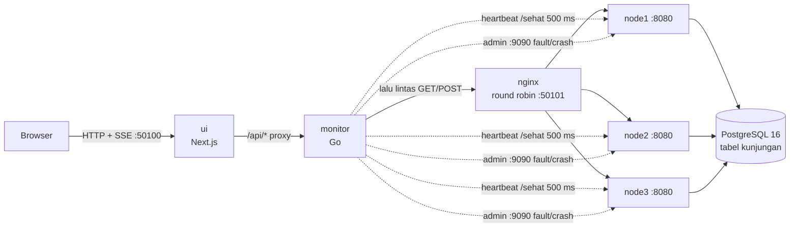

# Bab 1: Cluster Visualizer

Demo untuk **Bab 1 Sistem Terdistribusi 101** (buku ajar) dan **slide P01**. Tiga node Go identik
berjalan di belakang load balancer nginx dan menyimpan data bersama di satu PostgreSQL. Setiap node
punya port admin untuk menyuntik masalah jaringan dan kegagalan. Service monitor melakukan heartbeat
ke setiap node, mengirim lalu lintas lewat nginx, dan menyiarkan status ke UI Next.js lewat
Server-Sent Events (SSE).

Yang bisa dilihat di kelas:

| Konsep di Bab 1 / P01 | Bagian buku | Di demo |
|---|---|---|
| Definisi: banyak elemen otonom tampak sebagai satu sistem yang koheren; transparansi | §Apa Itu Sistem Terdistribusi | klien hanya kenal nginx; total data di Postgres sama dari node mana pun |
| Failure transparency dan batasnya | §Transparansi | node mati: GET tetap sukses karena nginx retry; POST tidak di-retry |
| Matematika redundansi, `A = 1 − (1 − a)^n`, seri vs paralel, MTTR | §Manfaat 2 | panel "Matematika redundansi" (a terukur per node, prediksi, terukur klien); tombol Crash |
| Delapan fallacies of distributed computing | §Harga yang Dibayar | panel fallacies + tombol Lambat, Jitter, Drop, Hang, Mati |
| Latency numbers | §Latency numbers | panel "Mengukur Sendiri" 1 dan 4 |
| Partial failure: request hilang, server mati, response hilang | §Dua hal yang membuat sulit | Drop req, Mati/Crash, Drop resp; panel "klien vs database" |
| Tidak ada jam bersama | §Dua hal yang membuat sulit | Jam +5 s, offset jam (cara Cristian), baris dengan jam mundur |
| Monolith vs microservices | §Evolusi Arsitektur | "Mengukur Sendiri" 3: fungsi lokal vs panggilan HTTP, tabel ringkas |
| Mengukur Sendiri | §Mengukur Sendiri | RTT TCP/HTTP, RTT browser, throughput, perbandingan dengan Tabel latency |

## Arsitektur



- **node1..3** (`services/node`): endpoint `GET /sehat`, `GET /ping`, `GET /api/sapa` (baca,
  idempotent), `POST /api/catat` (tulis satu baris), `GET /api/statistik`, `GET /api/hitung`.
  Port admin `9090` (tidak lewat nginx): `GET|POST /admin/fault`, `POST /admin/crash`.
- **Fault** yang bisa disuntik: `latency_ms`, `jitter_ms`, `drop_request_pct` (koneksi diputus
  dengan RST sebelum diproses), `drop_response_pct` (diproses, lalu koneksi diputus tanpa jawaban),
  `mode` = `normal` | `hang` (tidak pernah menjawab) | `mati` (port ditutup, connection refused),
  `skew_ms` (jam node digeser). `crash` membuat proses keluar dengan kode 1; Docker menyalakannya lagi
  (`restart: unless-stopped`).
- **nginx** (`nginx/default.conf`): round robin, passive health check `max_fails=2 fail_timeout=5s`,
  `proxy_read_timeout 2s`, `proxy_next_upstream error timeout` (POST yang sudah terkirim tidak
  diulang). Header `X-Upstream` berisi daftar node yang dicoba; `a, b` berarti terjadi retry.
- **monitor** (`services/monitor`): heartbeat 500 ms dengan timeout 1 s. Status: `hidup`,
  `lambat` (RTT ≥ 150 ms), `dicurigai` (1–2 heartbeat gagal), `mati` (≥ 3 gagal berturut-turut).
  Monitor tidak pernah tahu pasti node mati; ia hanya tahu jawabannya tidak datang. Generator lalu
  lintas open loop (default 8 req/s GET), timeout klien 5 s.
- **ui** (`ui`): satu halaman; data real-time dari `/api/stream` (SSE). Route `/api/*` di Next.js
  meneruskan ke monitor, alamatnya dibaca saat runtime dari `MONITOR_URL`.

## Menjalankan

```bash
cd bab01-sistem-terdistribusi-101
cp .env.example .env          # di server lab: BIND_ADDR=10.100.21.22
docker compose up -d --build
# buka http://127.0.0.1:50100
```

Uji otomatis dari keadaan bersih (build, uji, lalu `down -v`):

```bash
bash uji.sh
```

## Port

| Port host | Service | Keterangan |
|---|---|---|
| 50100 | ui | halaman Cluster Visualizer |
| 50101 | nginx | load balancer, contoh `curl -i $BIND_ADDR:50101/api/sapa` |
| 50102 | monitor | API monitor (`/api/status`, `/api/stream`, ...) |
| 50111–50113 | node1–node3 | port utama tiap node langsung, tanpa nginx |

Port admin node (9090) dan PostgreSQL tidak dibuka ke host. Semua port terikat ke `${BIND_ADDR}`.

## Skenario demo di kelas (±30 menit)

Siapkan: buka UI di proyektor, satu terminal, dan Grafana (opsional). Tekan **Reset statistik + data**
sebelum mulai.

1. **Satu sistem yang koheren (5 menit).** Tunjukkan topologi: titik berwarna bergerak dari nginx ke
   ketiga node secara bergantian, grafik "Request per detik per node" terbagi rata. Di terminal:
   `for i in $(seq 6); do curl -s $BIND_ADDR:50101/api/sapa; done`. Field `node` berganti, tetapi
   `total` sama: tiga mesin otonom, satu data. Ini definisi van Steen dan location transparency.
2. **Fallacy 2, latency itu nol (4 menit).** Pada node2 klik **Lambat**. Node2 menjadi kuning
   `◐ lambat`, garis p95 di grafik latency naik ke ±400 ms, sedangkan p50 tetap rendah. Tanyakan:
   "Pengguna mana yang merasakan?" (sepertiga request). Tunjukkan bahwa round robin tidak tahu node
   lambat (fallacy 8, jaringan homogen). Klik **Pulihkan**.
3. **Partial failure, kasus (b): server mati (5 menit).** Pada node3 klik **Mati**. Status berubah
   `? dicurigai` lalu `✕ mati` setelah tiga heartbeat gagal: tanyakan mengapa monitor tidak langsung
   menyatakan mati. Grafik distribusi: node3 hilang, request tetap sukses (connection refused langsung
   diteruskan nginx ke node lain). Panel redundansi: a node3 turun, prediksi paralel tetap ±100%.
   Matikan juga node1: layanan tetap hidup dengan satu node. Pulihkan keduanya.
4. **Hang lebih buruk dari mati (4 menit).** Pada node1 klik **Hang**. Kali ini nginx harus menunggu
   `proxy_read_timeout` 2 s sebelum mencoba node lain: grafik latency melonjak ke >2000 ms, kolom
   "sukses setelah retry nginx" bertambah. Inilah fallacy 1: tanpa timeout, klien menunggu selamanya.
   Pulihkan.
5. **Partial failure, kasus (c): response hilang (6 menit).** Reset, pilih metode **tulis (POST)**,
   lalu pada node2 klik **Drop resp 30%**. Amati panel "klien vs database": baris "tercatat tanpa
   konfirmasi ke klien" terus bertambah. Server sudah menulis ke Postgres, jawabannya hilang, nginx
   tidak mengulang POST (supaya tidak menulis dua kali). Bandingkan dengan **Drop req 30%** (kasus a):
   request diputus sebelum diproses, sehingga baris tidak bertambah. Dari sisi klien keduanya sama:
   error. Jembatan ke idempotency key di Bab 4.
6. **MTTR (3 menit).** Klik **Crash** pada node3. Proses keluar, Docker menyalakannya lagi dalam
   hitungan detik; amati berapa detik status `mati` sebelum kembali `hidup`. Kaitkan dengan
   `A = MTBF / (MTBF + MTTR)`: memperkecil MTTR menambah angka sembilan.
7. **Tidak ada jam bersama (3 menit).** Metode tulis, klik **Jam +5 s** pada node1. Panel jam:
   offset node1 ±+5000 ms (diperkirakan dengan cara Cristian). Tunggu beberapa detik, pulihkan node1:
   "pasangan baris yang jam node-nya mundur" bertambah, artinya baris yang ditulis belakangan tampak
   terjadi lebih dulu. Pintu masuk logical clock.
8. **Mengukur Sendiri (5 menit).** Jalankan (1) RTT monitor → node: TCP connect antar-container
   puluhan mikrodetik, HTTP lewat nginx lebih lambat karena satu hop tambahan (transport cost).
   (2) Uji throughput dengan konkurensi 1, 8, lalu 32: req/s naik sampai jenuh, setelah itu yang naik
   latency. (3) Monolith vs terdistribusi dengan n = 100: hasil identik, panggilan jaringan ribuan
   kali lebih lambat. (4) Bandingkan dengan tabel latency numbers, lalu minta mahasiswa menjalankan
   `ping`, `traceroute`, dan `curl -w` dari buku ke tiga benua.

## Log di Grafana

1. Jalankan observability bersama sekali: `docker compose -f ../shared/observability/compose.yaml up -d`
   lalu buka Grafana di `http://$BIND_ADDR:50000`.
2. Dashboard **Bab 1 · Cluster Visualizer** (`grafana/bab01-cluster-visualizer.json`, dipasang ke
   folder dashboard bersama): request per node, hasil request di node (ok/drop/hang), status HTTP
   nginx, jumlah retry, durasi p95, log WARN/ERROR (perubahan fault, status node, crash), dan
   pencarian satu `request_id`.
3. Explore manual, contoh:
   - `{compose_project="sister-bab01", compose_service="nginx"} | json | upstream=~".*,.*"` (request
     yang di-retry)
   - `{compose_project="sister-bab01"} | json | msg="status node berubah"`
   - Ambil `X-Request-ID` dari `curl -i $BIND_ADDR:50101/api/sapa`, lalu cari
     `{compose_project="sister-bab01"} |= "<request_id>"`: baris nginx dan baris node untuk request
     yang sama.

Semua service Go menulis log JSON satu baris (`time`, `level`, `msg`, `service`, `node`,
`request_id`); nginx menulis access log JSON dengan `request_id` yang sama.

## Membersihkan

```bash
docker compose down -v
docker builder prune -f
# bila image demo ingin dihapus juga:
docker image rm sister-bab01-node:1.0 sister-bab01-monitor:1.0 sister-bab01-ui:1.0
```

## Catatan

- Subnet compose `172.29.101.0/24` dengan IP node tetap, karena nginx membaca alamat node sekali saat
  mulai; node yang crash dan di-restart tetap di alamat yang sama.
- Semua container berjalan di satu mesin, jadi RTT antar-node jauh lebih kecil daripada RTT antar-server
  sungguhan (±500 µs dalam satu data center).
- Crash berulang dalam waktu singkat memicu backoff restart Docker: node yang baru hidup kurang dari
  10 detik lalu crash lagi bisa menunggu puluhan detik sebelum dinyalakan. Ini juga contoh MTTR yang
  membesar; beri jeda sebelum menekan Crash lagi.
- Lalu lintas demo memakai HTTP tanpa TLS (fallacy 4); TLS dibahas di Bab 3.
