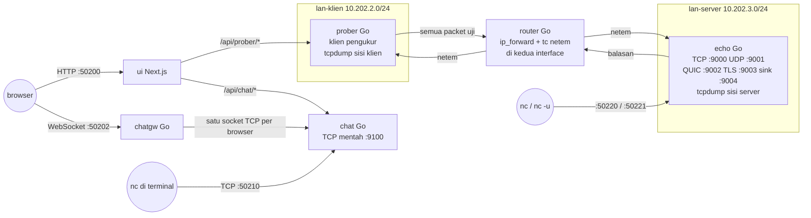

# Bab 2: Jaringan untuk Sistem Terdistribusi (TCP, UDP, QUIC)

Demo untuk **Bab 2 buku** *Sistem Terdistribusi dan Komputasi Berkinerja Tinggi* dan **slide P02**
(`P02-jaringan-tcp-udp-quic`). Semua yang dibahas di subbab Socket API, TCP, UDP, QUIC, dan
Mengamati Packet dapat dilihat langsung di browser:

| Konsep di buku / slide | Di mana terlihat di demo |
|---|---|
| Socket API: `socket()`, `connect()`, `accept()`, `send()`, `recv()`, `close()` | halaman **Socket API & packet**: timeline panggilan di klien dan server |
| Three-way handshake dan penutupan koneksi (SYN, SYN-ACK, ACK, FIN) | ladder diagram dari `tcpdump` di kedua sisi |
| Framing: TCP adalah byte stream, satu `recv()` bukan satu message | opsi "send() beruntun": berapa baris yang tiba dalam satu `recv()` |
| Retransmission, RTT maksimum melonjak saat loss | halaman **Perbandingan transport** dan panah oranye di ladder |
| UDP: kirim dan lupakan, message hilang tidak dikirim ulang | tanda × pada grafik RTT, kolom "hilang" |
| QUIC: handshake 1 RTT, 0-RTT pada koneksi ulang | tabel handshake: TCP 1 RTT, TCP+TLS 1.3 2 RTT, QUIC 1 RTT, QUIC 0-RTT 0 RTT |
| Head-of-line blocking pada TCP, stream independen pada QUIC | halaman **Head-of-line blocking** |
| `tc netem`: membuat jaringan "jelek" dengan sengaja | panel netem (delay, jitter, loss, rate) di setiap halaman |
| `tcpdump`, `ss -ti` | keluaran tcpdump mentah dan tombol `ss -tni` |
| Eksperimen "TCP vs UDP saat jaringan buruk" + templat Tabel hasil | tabel "Catatan hasil" yang terisi otomatis per putaran |
| Contoh socket chat | halaman **Socket chat**: `nc` dan browser di ruang yang sama |

## Arsitektur



* **router** adalah container dengan `NET_ADMIN` yang meneruskan packet antara dua network dan memasang
  `tc qdisc ... netem` di egress kedua interfacenya. Karena itu delay kena di dua arah (RTT naik kira-kira
  2 × delay, sama seperti contoh `netem` pada `lo` di buku) dan packet yang dibuang netem **terlihat di
  tcpdump pengirim tetapi tidak pernah muncul di tcpdump penerima**.
* **prober** dan **echo** memasang route ke subnet seberang lewat router (`ip route replace`), sehingga
  jalur data selalu melewati netem. API kontrol (tcpdump, trace) lewat network `front` tanpa netem.
* Semua service Go memakai **satu image** (`sister-bab02-go:dev`, alpine + iproute2 + tcpdump) agar hemat disk.
* Sertifikat TLS/QUIC self-signed dibuat saat runtime oleh service echo; prober tidak memverifikasinya
  (`InsecureSkipVerify`, hanya untuk demo kelas). Gateway WebSocket menerima Origin apa pun (demo lab).

## Menjalankan

```bash
cd bab02-jaringan-tcp-udp-quic
cp .env.example .env          # BIND_ADDR=127.0.0.1 ; di server lab: 10.100.21.22
docker compose up -d --build
# buka http://127.0.0.1:50200
```

Uji otomatis (build, cek semua endpoint, lalu `down -v`): `bash uji.sh`.

Butuh kernel Linux dengan modul `sch_netem` (dimuat otomatis saat `tc` pertama kali dipakai). Di WSL2
atau macOS (Docker Desktop) netem bisa tidak tersedia; pakai VM Linux.

## Port

| Port host | Service | Isi |
|---|---|---|
| 50200 | ui | UI Next.js |
| 50201 | prober | API prober (`/api/run`, `/api/netem`, `/api/hol`, `/api/trace`, `/api/ss`) |
| 50202 | chatgw | WebSocket chat (`/ws?nick=...`) |
| 50210 | chat | socket TCP mentah: `nc <host> 50210` |
| 50220/tcp | echo | echo TCP per baris: `nc <host> 50220` |
| 50221/udp | echo | echo UDP: `nc -u <host> 50221` |
| 50222/udp | echo | QUIC (ALPN `bab02-echo`) |

Semua diikat ke `${BIND_ADDR}`. Lalu lintas dari host ke 50220–50222 tidak melewati router netem;
yang melewati netem hanya jalur prober → echo.

Subnet internal `10.202.2.0/24` dan `10.202.3.0/24` dapat diganti lewat `KLIEN_NET` dan `SERVER_NET` di `.env`.

## Skenario demo di kelas (±30 menit)

**1. Socket API dan handshake (Socket API & packet).**
1. Buka tab *Socket API & packet*, pilih TCP, 3 message, klik **Rekam** (netem Normal).
2. Tunjukkan urutan di kiri (klien): `socket()`, `connect()`, `send()`, `recv()`, `close()`; di kanan (server):
   `accept()` baru muncul **setelah** SYN, SYN-ACK, ACK. Hubungkan dengan Gambar three-way handshake di buku
   dan slide "Urutan panggilan".
3. Tunjukkan FIN di akhir dan `recv() = 0` di server: begitulah server tahu klien menutup koneksi.
4. Klik preset **Praktikum: 50 ms, loss 5%**, rekam lagi. Kemiringan panah sekarang 50 ms. Ulangi beberapa
   kali sampai ada panah merah (×, packet dibuang netem) dan panah oranye (retransmission). Catat jeda
   RTO yang dipadatkan di sisi kiri (mis. "jeda 1000 ms"): itu retransmission timeout SYN.
5. Centang **send() beruntun** (Normal, 2 message). Lihat di server apakah `recv()` menerima `"halo 1\nhalo 2\n"`
   dalam satu panggilan: inilah pertanyaan analisis nomor 4 di slide praktikum dan alasan perlunya framing.
6. Pilih UDP: tidak ada handshake, `connect()` tidak mengirim packet, `close()` juga tidak. Pilih QUIC:
   packet pertama `QUIC Initial` (berisi ClientHello), lalu `QUIC Handshake`, lalu `QUIC 1-RTT` terenkripsi.
7. Buka "Keluaran tcpdump mentah" untuk menunjukkan bentuk asli perintah `tcpdump -nn` dari buku.

**2. TCP vs UDP vs QUIC saat jaringan buruk (Perbandingan transport).** Ini praktikum P02.
1. Netem **Normal**, klik **Jalankan uji** (100 message). Semua RTT di bawah 1 ms; catat di tabel hasil.
2. Klik preset **Praktikum: 50 ms, loss 5%**, jalankan lagi. Amati:
   * median ketiganya ≈ 100 ms (2 × 50 ms),
   * TCP dan QUIC tetap 100/100 balasan, tetapi titik-titik melonjak ke 300–500 ms (retransmission);
     **maks jauh di atas median**,
   * UDP tidak pernah melonjak, tetapi beberapa message hilang (×). Bandingkan persentasenya dengan
     1 − 0,95² ≈ 9,75%.
3. Tabel handshake: TCP ≈ 1 RTT, TCP + TLS 1.3 ≈ 2 RTT, QUIC ≈ 1 RTT, QUIC 0-RTT ≈ 0 RTT (data ikut packet
   pertama). Ini Gambar "Jumlah RTT sebelum data aplikasi pertama terkirim" dan contoh "Selisih yang terasa".
   Ingatkan kotak "0-RTT dan replay".
4. Throughput: atur loss 2% dan delay 50 ms. TCP dan QUIC turun drastis (congestion control mengecilkan
   laju), UDP tetap mengirim secepatnya dan tidak peduli yang hilang. Dengan `rate` (mis. 10 Mbit/s) terlihat
   bandwidth sebagai batas atas; hubungkan dengan subbab latency vs bandwidth.
5. Tabel "Catatan hasil" adalah Tabel templat praktikum di buku; mahasiswa menyalinnya ke laporan.

**3. Head-of-line blocking (Head-of-line blocking).**
1. Atur delay 30 ms, loss 5%. Klik **Jalankan TCP dan QUIC** (3 stream).
2. Grafik TCP: lonjakan muncul sebagai tiang vertikal berisi ketiga warna sekaligus, karena message stream
   lain yang sudah tiba tertahan menunggu segmen yang hilang (Gambar head-of-line blocking di buku).
   Grafik QUIC: lonjakan hanya satu warna. Angka "tersendat bersamaan dengan stream lain" tinggi pada TCP
   (biasanya 70–100%) dan rendah pada QUIC.
3. Kaitkan dengan HTTP/2 vs HTTP/3 (Bab 3).

**4. Socket chat (Socket chat).**
1. Buka tab *Socket chat* di dua browser/laptop, klik **Hubungkan**.
2. Di terminal: `nc <host> 50210`, lalu `/nick budi`, ketik pesan. Pesan muncul di browser dan sebaliknya.
3. Tunjukkan tabel "Siapa yang terhubung": client nc punya alamat laptop, client browser punya alamat
   container gateway. Server hanya tahu ujung socket yang terhubung langsung (5-tuple).
4. Diskusi: framing satu baris, satu goroutine per client, antrean tulis terbatas (client lambat diputus),
   dan mengapa browser butuh gateway WebSocket.

Kembalikan netem ke **Normal** setelah selesai (aturan juga hilang bila container dimatikan).

## Log di Grafana

Semua service menulis log JSON satu baris (`time`, `level`, `msg`, `service`, `request_id` untuk request HTTP).
Jalankan observability bersama sekali: `docker compose -f ../shared/observability/compose.yaml up -d`,
buka Grafana (`http://<BIND_ADDR>:50000`), menu Explore, sumber data Loki:

```logql
{compose_project="sister-bab02"} | json
{compose_project="sister-bab02", compose_service="prober"} | json | msg="putaran selesai"
{compose_project="sister-bab02", compose_service="router"} | json | msg="netem diubah"
{compose_project="sister-bab02", compose_service="chat"} | json
```

Log `putaran selesai` memuat `netem`, `tcp_median`, `tcp_max`, `udp_median`, `udp_loss_pct`, dan `quic_median`,
sehingga hasil praktikum juga tercatat di Loki.

## Struktur

```
compose.yaml  .env.example  uji.sh
services/            satu modul Go (go.mod), satu Dockerfile untuk semua binary
  echo/              server echo TCP, UDP, QUIC, TLS, sink + API kontrol (tcpdump, trace, ss)
  router/            ip_forward + tc netem kedua arah
  prober/            pengukur RTT, loss, throughput, handshake, HOL, trace
  chat/              ruang chat socket TCP mentah
  chatgw/            gateway WebSocket <-> TCP
  internal/          netem, pcap (parser tcpdump + pencocokan dua sisi), trace, certs, netutil, logx, httpx
ui/                  Next.js (App Router): /, /hol, /socket, /chat
```

Uji unit Go: `cd services && go test ./...` (parser tcpdump, argumen tc, statistik, logika ruang chat).

## Membersihkan

```bash
docker compose down -v
docker builder prune -f
# image demo (opsional): docker image rm sister-bab02-go:dev sister-bab02-ui:dev
```
