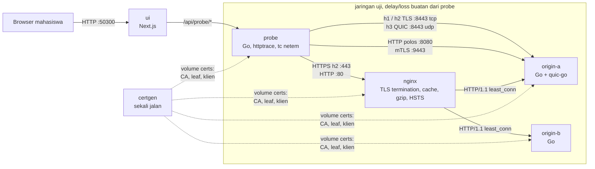

# Bab 3: HTTP, TLS, HTTPS (slide P03)

Demo untuk **Bab 3 buku Sistem Terdistribusi dan Komputasi Berkinerja Tinggi** dan **slide P03**.
Empat halaman UI memperlihatkan isi bab secara langsung:

| Halaman UI | Subbab buku / slide P03 | Yang diamati |
|---|---|---|
| 1. Waterfall h1 / h2 / h3 | "HTTP/1.1: Satu Request pada Satu Waktu", "Menghitung cost HTTP/1.1", "HTTP/2", "HTTP/3", "Mengukur: Ke Mana Waktu Habis?"; slide "Tiga versi dalam satu tabel", "Membaca hasilnya", Praktikum 1 | waterfall DNS, TCP connect, TLS handshake, TTFB, unduh per request; jumlah koneksi; median beberapa run; model RTT buku vs terukur; efek RTT dan packet loss |
| 2. TLS dan certificate | "Handshake TLS 1.3", "X.509 certificate dan rantai kepercayaan", "HTTPS lokal dengan Go", "mTLS"; slide "Melihat certificate dengan openssl" | versi TLS, cipher suite, ALPN, lama handshake TLS 1.3 vs 1.2, rantai leaf → intermediate → root, alasan certificate ditolak, mTLS tiga pemanggil |
| 3. HTTP polos vs HTTPS | "Tiga jaminan TLS"; Praktikum 2 (Wireshark) | byte yang terlihat penyadap: password dan cookie terbaca di HTTP, hanya ClientHello/ServerHello dan SNI di HTTPS |
| 4. Di depan server (nginx) | "Caching HTTP" (RFC 9111, ETag, 304), "Reverse proxy", "Load balancer L4 dan L7"; slide "Contoh: nginx sebagai load balancer L7" | X-Cache-Status MISS/HIT/REVALIDATED/EXPIRED, 304 tanpa body, gzip, redirect 301 + HSTS, distribusi least_conn, health check pasif |

Semua pengukuran dijalankan oleh service **probe** di sisi server. Browser hanya berbicara dengan UI
(port 50300), sehingga tidak pernah melihat certificate self-signed demo.

## Arsitektur



| Service | Image | Peran |
|---|---|---|
| `certgen` | `sister-bab03-go:dev` (dibangun dari `golang:1.24-alpine` → `alpine:3.20`) | membuat root CA, intermediate, leaf server, leaf klien mTLS ke volume `certs`, lalu keluar |
| `origin-a`, `origin-b` | `sister-bab03-go:dev` | server aplikasi Go: `:8080` HTTP polos, `:8443` HTTPS h1/h2 + HTTP/3, `:9443` mTLS |
| `nginx` | `nginx:1.28-alpine` | reverse proxy dan load balancer L7 di depan kedua origin |
| `probe` | `sister-bab03-go:dev` | klien pengukur; `cap_add: NET_ADMIN` untuk `tc netem` |
| `ui` | `sister-bab03-ui:dev` (`node:20-alpine`, Next.js 15 standalone) | visualisasi |

Ketiga binary Go (certgen, origin, probe) ada di satu image agar hemat disk. Kodenya di
`services/<nama>/`, disatukan oleh `services/go.work`.

### Catatan desain

- **RTT buatan.** RTT antar container di satu host di bawah 0,1 ms, sehingga h1, h2, dan h3 tampak sama
  cepat. Probe memasang `tc qdisc ... netem delay 25ms` di interface yang menuju jaringan `uji`
  (hanya di network namespace container probe, tidak menyentuh host). Delay dan loss dapat diubah
  dari halaman 1.
- **Certificate.** Tidak ada kunci di repo. `certgen` membuat CA baru setiap volume `certs` kosong
  (leaf berlaku 7 hari, intermediate 30 hari, root 1 tahun). Kunci privat CA tidak disimpan.
- **Browser tidak dipakai sebagai klien uji.** Browser modern menolak CA demo, dan pengukurannya
  dipengaruhi cache dan koneksi hangat. Probe membuat klien baru (koneksi dingin) di setiap run.
- **HTTP/1.1 di probe meniru browser:** maksimal 6 koneksi per host dan ALPN `http/1.1`.

## Menjalankan

```bash
cd bab03-http-tls-https
cp .env.example .env          # BIND_ADDR=127.0.0.1; di server lab 10.100.21.22
docker compose up -d --build --wait
# buka http://127.0.0.1:50300
```

Uji otomatis (build, start, cek semua endpoint, lalu `down -v`):

```bash
bash uji.sh
```

Mencoba dari host dengan `curl` (opsional, butuh CA demo dari volume):

```bash
docker compose cp certgen:/certs/ca.pem /tmp/ca-bab03.pem   # certgen sudah selesai, file tetap bisa disalin
F='dns=%{time_namelookup} tcp=%{time_connect} tls=%{time_appconnect} ttfb=%{time_starttransfer} total=%{time_total} versi=%{http_version}\n'
curl -so /dev/null -w "$F" --cacert /tmp/ca-bab03.pem --http1.1 https://localhost:50304/page
curl -so /dev/null -w "$F" --cacert /tmp/ca-bab03.pem --http2   https://localhost:50304/page
curl -so /dev/null -w "$F" --cacert /tmp/ca-bab03.pem --http3-only https://localhost:50304/page  # bila curl mendukung
openssl s_client -connect localhost:50303 -CAfile /tmp/ca-bab03.pem -showcerts </dev/null
curl -sI --cacert /tmp/ca-bab03.pem https://localhost:50303/api/katalog   # X-Cache-Status, ETag, HSTS
```

Bila `BIND_ADDR` bukan `127.0.0.1`, tambahkan alamat itu ke `EXTRA_SANS` di `.env` sebelum start
agar nama host cocok dengan SAN certificate. Pengukuran dari host tidak terkena netem probe.

## Skenario demo di kelas (±30 menit)

**Persiapan.** `docker compose up -d --build --wait`, buka `http://<BIND_ADDR>:50300` di proyektor,
dan (opsional) Grafana `http://<BIND_ADDR>:50000`.

### A. Ke mana waktu habis? (halaman 1, ±10 menit)

1. Biarkan delay 25 ms, loss 0. Klik **Ukur h1, h2, h3** (30 aset, 5 run).
   Amati tabel ringkasan: h1 paling lambat, h2 dan h3 jauh lebih cepat. Kolom *Model buku*
   menghitung contoh buku "Memuat 1 HTML dan 30 file pendukung": h1 = 10 RTT, h2 = 4 RTT, h3 = 3 RTT.
2. Lihat waterfall h1: enam baris pertama aset membuka koneksi baru (hijau TCP, kuning TLS), sisanya
   abu-abu **antre** karena satu koneksi HTTP/1.1 hanya melayani satu request pada satu waktu.
   Kaitkan dengan *head-of-line blocking* di layer aplikasi dan batas 6 koneksi per host.
3. Lihat waterfall h2: satu koneksi, semua aset berangkat bersamaan (*multiplexing* stream).
4. Lihat waterfall h3: baris HTML tidak punya segmen TCP; handshake QUIC + TLS 1.3 menjadi satu
   segmen kuning sepanjang ±1 RTT, sehingga HTML tiba ±1 RTT lebih cepat dari h2.
5. Naikkan delay ke 100 ms, **Terapkan**, ukur lagi. Selisih h1 dan h3 membesar sebanding RTT
   (buku: "paling berharga bagi pengguna yang jauh").
6. Kembalikan delay 25 ms, isi *Server berpikir* = 300 ms, ukur. Kini segmen biru (TTFB) baris HTML
   mendominasi dan selisih antarversi relatif kecil: "memilih HTTP/3 untuk masalah query lambat
   adalah memperbaiki bagian yang salah".
7. (Opsional) delay 25 ms + loss 3 %. Run menjadi tidak stabil; tunjukkan mengapa buku menyarankan
   median dari banyak run. Diskusikan HOL blocking TCP pada h2 dibandingkan stream QUIC yang independen.

### B. TLS dan rantai kepercayaan (halaman 2, ±8 menit)

1. Klik **Tengok TLS origin dan nginx**. Tabel memperlihatkan empat koneksi: origin (Go) dan nginx
   (OpenSSL), masing-masing TLS 1.3 dan 1.2. Bandingkan kolom *TLS handshake* dengan *TCP connect*
   (≈ 1 RTT): TLS 1.3 ≈ 1 RTT, TLS 1.2 ≈ 2 RTT. Bandingkan juga nama cipher suite keduanya.
2. Kartu kiri: server mengirim leaf + intermediate. Kartu kanan: klien menyusun rantai sampai root
   "Sister Demo Root CA" yang dipasang di trust store probe.
3. Tabel *Mengapa browser bisa menolak*: certificate yang sama ditolak bila root tidak ada di trust
   store (inilah peringatan merah di browser), bila nama host tidak cocok dengan SAN, dan bila sudah
   kedaluwarsa.
4. Klik **Uji mTLS**. Pemanggil dengan certificate dari CA demo diterima ("halo layanan-pesanan"),
   pemanggil tanpa certificate dan penyusup self-signed ditolak saat handshake (zero trust).

### C. Apa yang dilihat penyadap (halaman 3, ±5 menit)

1. Klik **Kirim form login dan tangkap byte-nya**.
2. Panel HTTP polos: request line, header `Cookie`, dan `password=rahasia123` terbaca (ditandai merah).
3. Panel HTTPS: hanya ClientHello (dengan SNI `origin-a` terbaca), ServerHello, ChangeCipherSpec,
   lalu deretan ApplicationData terenkripsi. Tanyakan: "Bisakah Anda membaca isi response? Mengapa
   tidak?" (pertanyaan Praktikum 2).

### D. Di depan server (halaman 4, ±7 menit)

1. Klik **GET /api/katalog**: MISS, kolom *Origin dipanggil?* = ya.
2. Klik lagi dalam 5 detik: HIT, origin tidak dipanggil.
3. Klik **GET dengan If-None-Match**: 304, 0 byte di kabel.
4. Tunggu lebih dari 5 detik, klik **GET /api/katalog**: REVALIDATED; origin dipanggil tetapi hanya
   menjawab 304 (alur gambar "Cache hit dan validasi ulang dengan ETag" di buku).
5. Klik **Ubah versi katalog di origin**, tunggu 5 detik, GET lagi: EXPIRED dengan ETag baru.
6. **Bandingkan tanpa/dengan gzip**: byte di kabel turun beberapa kali lipat; ETag menjadi weak (`W/`).
7. **Minta lewat http:// dan https://**: 301 ke HTTPS, lalu header `Strict-Transport-Security`.
8. **Kirim 12 request ke /api/siapa**: terbagi ke origin-a dan origin-b. Klik **Buat origin-b sakit**:
   klien tetap mendapat 200 karena nginx mencoba ulang ke origin-a; kolom *Upstream yang dicoba*
   memperlihatkan `origin-b → origin-a` sampai origin-b diistirahatkan (`max_fails`, `fail_timeout`).
   Klik **Sembuhkan origin-b** di akhir.

## Port

| Port host (`${BIND_ADDR}`) | Service | Isi |
|---|---|---|
| 50300 | ui | UI Next.js |
| 50301 | probe | API JSON probe (dipakai UI; boleh di-curl) |
| 50302 | nginx | HTTP polos (redirect 301) |
| 50303 | nginx | HTTPS + HTTP/2 (cache, gzip, HSTS, load balancer) |
| 50304 tcp/udp | origin-a | HTTPS h1/h2 (tcp) dan HTTP/3 (udp) |
| 50305 | origin-a | HTTPS mTLS |

## Log di Grafana

Jalankan sekali `docker compose -f shared/observability/compose.yaml up -d`, buka Grafana
`http://<BIND_ADDR>:50000`, menu Explore, sumber Loki:

```logql
{compose_project="sister-bab03"} | json
{compose_project="sister-bab03", compose_service="probe"} | json | msg="pengukuran selesai"
{compose_project="sister-bab03", compose_service="nginx"} | json | cache != ""
{compose_project="sister-bab03", compose_service="origin-a"} |= "mTLS"
```

Semua service Go menulis log JSON satu baris (`time`, `level`, `msg`, `service`, `request_id`).
nginx menulis access log JSON dengan field `cache` (`$upstream_cache_status`) dan `upstream`.
Request aset waterfall di origin dicatat di level debug (`LOG_DEBUG=1`) agar log tidak banjir.

## Membersihkan

```bash
docker compose down -v        # hapus container, network, dan volume certs (CA ikut hilang)
docker builder prune -f
```

## Struktur

```
bab03-http-tls-https/
  compose.yaml  .env.example  uji.sh  README.md
  nginx/nginx.conf
  services/
    Dockerfile  go.work
    certgen/   CA, intermediate, leaf (crypto/x509)
    origin/    server HTTP polos, HTTPS h1/h2, HTTP/3 (quic-go), mTLS
    probe/     waterfall (httptrace), TLS inspect, sniff, cache/LB lewat nginx, netem
  ui/          Next.js (App Router): /, /tls, /sniff, /depan
```

Unit test Go: `cd services && go test ./certgen/ ./origin/ ./probe/` (rantai certificate, ETag/304,
parser TLS record dan SNI, simulasi browser h1/h2/h3 terhadap server lokal, sniff polos vs TLS).
