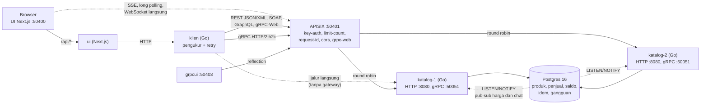

# Bab 4: Komunikasi, RPC, REST, gRPC, GraphQL (slide P04)

Demo kelas untuk **Bab 4 buku Sistem Terdistribusi dan Komputasi Berkinerja Tinggi** dan **slide P04**.
Satu domain sederhana, yaitu katalog produk, penjual, dan saldo pembeli, disimpan di Postgres dan dilayani oleh
service Go lewat **setiap protokol** yang dibahas di bab ini. Semua protokol ada di belakang satu API gateway
(APISIX). UI Next.js menjalankan permintaan yang sama lewat protokol-protokol itu berdampingan.

| Subbab buku / bagian slide | Yang diperlihatkan demo |
|---|---|
| Akar: RPC, semantik pemanggilan (at-most-once, at-least-once, exactly-once) | halaman **Timeout & Retry**: retry tanpa kunci memotong saldo berkali-kali, dengan idempotency key sekali |
| Sejarah: era XML dan era biner | **SOAP 1.1 + WSDL** dan **REST XML** di samping JSON dan Protobuf |
| REST modern, OpenAPI, error RFC 9457, ETag | `GET /v1/produk/{id}` JSON/XML (content negotiation), Swagger UI, Problem Details, `ETag`/`304` |
| gRPC mendalam: Protobuf, empat mode panggilan, deadline, status code, metadata, interceptor, reflection, gRPC-Web | `katalog.proto` (unary, server/client/bidi streaming), bongkar wire format Protobuf byte per byte, `DEADLINE_EXCEEDED`, idempotency key lewat metadata, grpcui, gRPC-Web lewat APISIX |
| Load balancing gRPC (L4 tidak cukup) | APISIX menyeimbangkan setiap panggilan unary di satu koneksi HTTP/2 ke dua replica |
| GraphQL, N+1, DataLoader | 51 query SQL (naif) dibanding 2 query (DataLoader) untuk 50 produk, GraphiQL |
| Real-time ke klien | polling, long polling, SSE, gRPC server streaming, dan **WebSocket chat**; pub-sub antarreplica dengan Postgres `LISTEN/NOTIFY` |
| API gateway, north-south | APISIX: routing per path, key-auth, rate limit (`limit-count`), request-id, CORS, proxy gRPC, gRPC-Web |
| Serialization JSON vs Protobuf | produk 42 Kopi 25000: **37 byte** JSON, **12 byte** Protobuf (`08 2A 12 04 4B 6F 70 69 18 A8 C3 01`) |
| Panggilan andal: timeout, retry + exponential backoff + jitter, idempotency key | server dibuat lambat/gagal dari UI; timeline setiap percobaan |
| Mengukur latency: mengapa rata-rata menipu | P50/P90/P99 dan rata-rata per protokol, jalur lewat gateway dibanding langsung |

## Arsitektur



- **katalog** (`services/katalog`, dua replica): satu binary Go yang melayani REST JSON/XML, SOAP 1.1, GraphQL,
  SSE, long polling, WebSocket di port 8080, dan gRPC di port 50051 (health dan reflection aktif). Swagger UI dan
  GraphiQL di-embed di binary (`/docs/`), jadi tidak butuh internet saat kelas.
- **klien** (`services/klien`): pemanggil yang dipakai UI. Semua protokol diukur dari tempat yang sama (di dalam
  jaringan Docker), sehingga perbandingan adil. Ia juga menjalankan logika retry (timeout, backoff, jitter,
  idempotency key).
- **APISIX** (`apisix/`): mode standalone, satu file `apisix.yaml`, tanpa etcd dan tanpa Admin API. Endpoint
  `/admin/*` milik katalog sengaja **tidak** dibuka di gateway.
- Kedua service Go berada dalam satu Go module (`services/go.mod`) karena berbagi kode `gen/` dari `katalog.proto`.

## Menjalankan

```bash
cd bab04-rpc-rest-grpc-graphql
cp .env.example .env          # di server lab: BIND_ADDR=10.100.21.22
docker compose up -d --build
# UI:       http://127.0.0.1:50400
# gateway:  http://127.0.0.1:50401   (Swagger UI: /docs/swagger.html, GraphiQL: /docs/graphiql.html, WSDL: /soap?wsdl)
# grpcui:   http://127.0.0.1:50403
bash uji.sh                   # uji otomatis dari keadaan bersih; selalu down -v di akhir
```

Mengubah `katalog.proto`: `cd services && buf generate` (butuh `buf`, `protoc-gen-go`, `protoc-gen-go-grpc`).
Hasilnya (`services/gen/`) ikut di-commit agar build Docker tidak butuh `protoc`.

## Port

| Port host | Service | Isi |
|---|---|---|
| 50400 | ui | UI Next.js "Protocol Playground" |
| 50401 | apisix | gateway: HTTP/1.1 dan h2c (gRPC) di port yang sama |
| 50403 | grpcui | UI web gRPC (memakai reflection lewat APISIX) |
| – | katalog-1, katalog-2, klien, postgres | hanya di jaringan Docker, tidak dibuka ke host |

Semua port diikat ke `${BIND_ADDR}`.

## Skenario demo di kelas

Perkiraan 45–60 menit. Buka UI di proyektor; mahasiswa bisa membuka UI yang sama lewat wg0.

### 1. Data yang sama, ukuran berbeda (Protocol Playground, `/`)

1. Biarkan operasi **Ambil satu produk**, ID 42, jalur **Lewat APISIX**. Klik **Jalankan semua protokol**.
2. Tunjuk tabel: REST JSON 37 byte, REST XML 65 byte, SOAP sekitar 290 byte, GraphQL 57 byte, gRPC **12 byte**.
   Ini persis angka di slide "Data yang sama, ukuran berbeda".
3. Buka kartu gRPC, bagian **bongkar wire format Protobuf**: `08 2A` = field 1 varint 42, `12 04 4B 6F 70 69` =
   field 2 panjang 4 "Kopi", `18 A8 C3 01` = field 3 varint 25000. Tanyakan: mengapa nama field tidak ikut dikirim?
   (karena kontrak `.proto` sudah ada di kedua sisi; field number yang dikirim).
4. Buka kartu SOAP: perlihatkan amplop `soap:Envelope`, header `SOAPAction`, dan buka tautan WSDL di halaman Gateway.
   Kaitkan dengan "era XML" di subbab sejarah.
5. Buka kartu gRPC-Web: body request adalah frame `00 00 00 00 02 08 2A` (flag, panjang 4 byte, Protobuf), dan
   response diakhiri frame trailer `80 ...` berisi `grpc-status:0`. APISIX yang menerjemahkan HTTP/1.1 ke gRPC HTTP/2.
6. Ganti operasi ke **Daftar 50 produk** dan jalankan lagi. Selisih ukuran membesar (JSON sekitar 2 KB, XML/SOAP
   sekitar 3,5 KB, Protobuf sekitar 0,8 KB). Lihat grafik latency: di jaringan lokal selisihnya kecil. Ini bahan
   pertanyaan tugas "pada kondisi apa gRPC unggul jelas, dan kapan selisihnya tidak berarti?".
7. Ganti jalur ke **Langsung ke katalog-1** untuk melihat biaya satu hop gateway. Naikkan **Ulang** ke 200 dan
   perlihatkan bahwa P99 jauh di atas P50 dan rata-rata tertarik pencilan (subbab "Mengapa rata-rata menipu").
8. Di bawah, klik **Jalankan keempat mode**: unary, server streaming (harga awal lalu menunggu perubahan), client
   streaming (empat `Penjualan`, satu `Ringkasan`), dan bidirectional (setiap tawaran langsung dijawab).

### 2. Real-time (`/realtime`)

1. Perlihatkan empat panel: polling, long polling, SSE, gRPC server streaming. Biarkan 10 detik: polling sudah
   mengirim 5 request walaupun tidak ada perubahan.
2. Isi harga baru, pilih **REST**, klik **Ubah harga**. SSE, long polling, dan gRPC stream langsung berubah dengan
   telat beberapa milidetik; polling baru tahu pada tik berikutnya (sampai 2 detik).
3. Ulangi lewat **SOAP**, **GraphQL**, dan **gRPC**: siapa pun pengubahnya, semua klien mendapat event yang sama. Log
   event memperlihatkan protokol pengubah dan node pengirim.
4. Kolom **node** memperlihatkan koneksi SSE menempel pada satu replica, sedangkan perubahan bisa datang lewat
   replica lain. Jelaskan peran pub-sub (Postgres `LISTEN/NOTIFY` di sini; Redis/NATS/Kafka di produksi).
5. **WebSocket chat**: minta dua atau tiga mahasiswa membuka halaman ini, klik **Sambung**, lalu saling kirim
   pesan. Tanda `[katalog-1 → katalog-2]` berarti pesan dikirim ke replica 1 dan diantar oleh replica 2.
   Buka DevTools tab Network untuk melihat `101 Switching Protocols`.
6. Nyalakan **ticker otomatis** agar stream ramai saat menjelaskan heartbeat (`: ping` setiap 15 detik di SSE) dan
   backpressure (buffer 32 pesan per klien; pesan dibuang untuk klien lambat).

### 3. Timeout, retry, idempotency (`/andal`)

1. Pengaturan awal: REST, timeout 400 ms, maks 4 percobaan, backoff 100 ms, full jitter; gangguan server: lambat
   800 ms **sesudah commit** untuk 2 request berikutnya.
2. Klik **Bandingkan tanpa vs dengan kunci**. Timeline: dua percobaan pertama kuning (timeout), percobaan ketiga hijau.
3. Kartu tanpa kunci: klien melihat satu keberhasilan, tetapi **saldo dipotong 3 kali** (Rp75.000). Ini kisah
   transfer ganda di awal bab: response hilang, klien tidak bisa membedakan "request hilang" dari "response hilang".
4. Kartu dengan kunci: saldo dipotong **1 kali**; percobaan ketiga bertanda *replay* karena server mengembalikan hasil
   tersimpan (`Idempotent-Replayed: true`). Jelaskan Algoritma idempotency di buku: kunci dan efek bisnis dalam satu
   transaksi dengan unique constraint.
5. Ganti protokol ke **gRPC** dan ulangi: statusnya kini `DEADLINE_EXCEEDED`, kunci dikirim lewat metadata
   `idempotency-key`.
6. Set **Gagal 503 sebelum proses** ke 50% dan lambat 0: retry kini aman walau tanpa kunci karena server belum
   memproses. Matikan jitter dan bandingkan pola jeda (100, 200, 400 ms) dengan versi jitter (acak di [0, nilai]).
7. Set **Untuk N request berikutnya** ke 0 (semua lambat): semua percobaan timeout, dan tanpa kunci saldo terpotong 4
   kali. Pesan: retry tanpa idempotency memperbesar kerusakan, dan retry tanpa batas memperbesar beban (retry storm).

### 4. Gateway dan GraphQL N+1 (`/gateway`)

1. **Tanpa API key**: 401 dari APISIX, request tidak pernah sampai ke service.
2. **Dengan API key (8×)**: 5 request 200 dengan sisa kuota menurun, lalu 429. Konfigurasinya di `apisix/apisix.yaml`
   (plugin `key-auth` dan `limit-count`).
3. **Kirim 12 HTTP + 6 gRPC**: kedua replica bergantian, termasuk gRPC yang semuanya lewat satu koneksi HTTP/2.
   Kaitkan dengan subbab "Load balancing gRPC: mengapa L4 saja tidak cukup".
4. **GraphQL N+1**: naif 51 query SQL, DataLoader 2 query, dan latency ikut turun. Buka GraphiQL, jalankan
   `DaftarDenganPenjual` dengan header `{"X-DataLoader": "on", "X-Debug-Extensions": "on"}` lalu tanpa
   `X-DataLoader`, dan bandingkan `extensions.sql_queries`.
5. Buka Swagger UI (coba `PUT /v1/produk/42/harga` sambil halaman Real-time terbuka di tab lain) dan grpcui
   (panggil `PantauHarga`, lalu ubah harga dari tab lain).

## Melihat log di Grafana

Jalankan sekali `docker compose -f shared/observability/compose.yaml up -d`, buka Grafana (port 50000),
Explore, sumber data Loki. Contoh LogQL:

```logql
{compose_project="sister-bab04"} | json
{compose_project="sister-bab04", compose_service=~"katalog-.*"} | json | msg="bayar"
{compose_project="sister-bab04"} | json | msg="graphql" | line_format "{{.node}} sql={{.sql_queries}} dataloader={{.dataloader}}"
{compose_project="sister-bab04"} |= "<request_id dari header X-Request-Id>"
```

Service Go menulis log JSON satu baris (`log/slog`) dengan field `time`, `level`, `msg`, `service`, `node`, dan
`request_id`. `request_id` berasal dari plugin `request-id` APISIX, sehingga satu request bisa diikuti dari gateway
sampai replica yang melayaninya. Log `bayar` memperlihatkan `idempotency_key` dan `dari_cache` setiap percobaan.

## Membersihkan

```bash
docker compose down -v
docker builder prune -f
# bila tidak dipakai lagi:
docker image rm sister-bab04-katalog:1.0 sister-bab04-klien:1.0 sister-bab04-ui:1.0
```

## Catatan keamanan dan batasan demo

- `.env.example` hanya berisi nilai contoh (`changeme`). API key APISIX dibaca dari `APISIX_DEMO_KEY`.
- WebSocket menerima origin mana pun dan CORS dibuka `*` agar UI di port lain bisa memanggil gateway. Ini untuk demo
  lokal saja.
- Endpoint fault injection (`/admin/gangguan`, `/admin/ticker`) hanya bisa dicapai dari jaringan Docker, tidak lewat
  APISIX.
- Pengukuran latency dilakukan di satu mesin; angka absolutnya bukan benchmark. Untuk tugas praktikum, gunakan
  `ghz`/`k6` atau `tools/perftest-desktop`.
