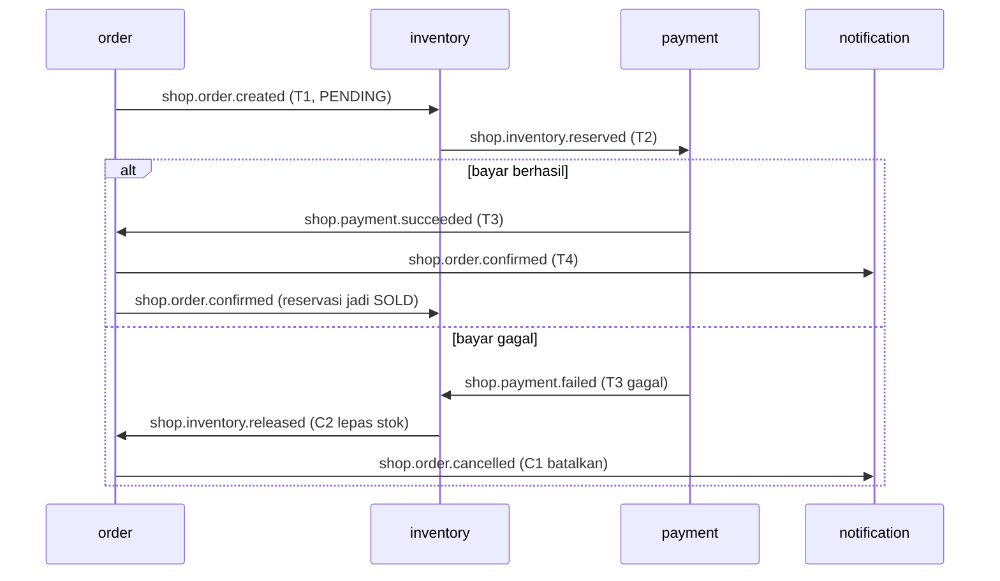

# Bab 5 · Toko Daring Microservices dan Messaging (+ Bank Syariah)

Demo untuk **Bab 5 (Arsitektur Microservices dan Messaging)** buku *Sistem Terdistribusi dan Komputasi
Berkinerja Tinggi* dan **slide P05**. Demo ini menjalankan studi kasus "Merancang Toko Daring"
(subbab *Studi Kasus: Merancang Toko Daring*) sebagai sistem sungguhan: service Go terpisah dengan
database masing-masing, API gateway, load balancer, broker NATS, saga, dan pola ketahanan. Semua
konsep dapat diamati dari satu UI.

Sejak 23 Nov 2026 aplikasi ini menjadi **bank + e-commerce**: ada service `bank` (bank syariah kecil:
cabang, nasabah, rekening, transaksi, akad pembiayaan) dan checkout toko dapat dibayar dari rekening
bank. **Aplikasi ini juga sumber data operasional mata kuliah Data Engineering** (repo `de-demo`):
pipeline DE membaca event stream `BANK`/`SHOP` dan CDC Debezium dari database `bank` dan `orders`.
Sampai UTS, aplikasi ditangani di mata kuliah Sistem Terdistribusi; DE menangani pipeline dan
analytics. Bentuk tabel dan event bank dikunci oleh kontrak data
`de-demo/platform/KONTRAK-DATA.md` (bagian "Layanan bank di aplikasi Sister"); jangan ubah nama
tabel, kolom, nilai enum, atau subject tanpa koordinasi.

| Konsep di buku/slide | Wujud di demo |
|---|---|
| API gateway: routing, auth, rate limiting (subbab *Pintu Masuk dan Menemukan Layanan*) | APISIX standalone: route `/api/catalog`, `/api/orders`, `/api/monitor`; `key-auth`; `limit-count` 20 req/10 s; `request-id` |
| Load balancer, service stateless 2 replica | nginx membagi `order-1` dan `order-2` (round robin, passive health check, `proxy_next_upstream`) |
| Synchronous vs asynchronous | order → catalog dan order → inventory lewat REST (synchronous); sisa alur lewat event NATS JetStream |
| Queue dan publish-subscribe | durable consumer JetStream dipakai bersama 2 replica (pesan dibagi); lab: queue group vs subscriber biasa |
| Delivery semantics dan idempotency | lab core NATS (at-most-once) vs JetStream (at-least-once); fault "crash sebelum ack" → redelivery → tabel `processed_messages` mendeteksi duplikat; `Idempotency-Key` pada checkout |
| Event-driven architecture dan transactional outbox | setiap service menulis event ke tabel `outbox` dalam transaksi yang sama, relay menerbitkannya (`FOR UPDATE SKIP LOCKED`, `Nats-Msg-Id`) |
| Saga choreography dan compensating action | T1 buat pesanan → T2 pesan stok → T3 tagih → T4 konfirmasi; bila T3 gagal: C2 lepas stok → C1 batalkan |
| Timeout, retry, backoff + jitter, circuit breaker, fallback | order: timeout 300/500 ms, retry dengan full jitter, `sony/gobreaker` (closed/open/half-open) yang terlihat di UI; fallback precheck stok dan fallback pencarian ke Postgres |
| Database per service | satu instance Postgres, database `catalog`, `orders`, `inventory`, `payment`, `notification`, `bank` |
| Transaksi lokal vs lintas service | transfer bank = dua baris + event dalam SATU transaksi database (`FOR UPDATE`); bayar belanja dari rekening = panggilan synchronous payment → bank di dalam saga (lintas database) |
| Pencarian (Elastic) | OpenSearch 2 node, index `products` 2 primary shard × 1 replica, pencarian fuzzy |
| Observability, distributed tracing | `X-Request-Id` dari APISIX diteruskan ke nginx, service, header NATS, dan event berikutnya; log JSON ke Loki |

## Arsitektur

```mermaid
flowchart LR
  B[Browser] --> UI[UI Next.js :50500]
  UI -->|REST + apikey| GW[APISIX :50501<br/>key-auth, limit-count, request-id]
  GW -->|/api/catalog| CAT[catalog]
  GW -->|/api/orders| LB[nginx order-lb :50502]
  GW -->|/api/monitor| MON[monitor]
  LB --> O1[order-1]
  LB --> O2[order-2]
  O1 & O2 -->|REST, timeout + breaker| CAT
  O1 & O2 -->|REST precheck, timeout + breaker| INV[inventory]
  CAT --> OS1[(OpenSearch-1)]
  CAT --> OS2[(OpenSearch-2)]
  subgraph NATS JetStream stream SHOP
    E((shop.*))
  end
  O1 & O2 -. outbox: order.created / confirmed / cancelled .-> E
  INV -. outbox: inventory.reserved / rejected / released .-> E
  PAY[payment] -. outbox: payment.succeeded / failed .-> E
  E -.-> INV & PAY & NOTIF[notification] & O1 & O2
  GW -->|/api/bank| BANK[bank]
  PAY -->|REST internal :8081<br/>bayar-belanja| BANK
  subgraph NATS JetStream stream BANK
    EB((bank.*))
  end
  BANK -. outbox: transaksi / nasabah / rekening / akad .-> EB
  MON -. subscribe shop.> bank.> audit.> lab.> .-> E
  MON -.-> EB
  CAT & O1 & O2 & INV & PAY & NOTIF & BANK --> PG[(Postgres<br/>1 instance, DB per service<br/>wal_level=logical)]
```

Alur saga (choreography, tanpa orchestrator):



Bila stok tidak cukup, inventory menerbitkan `shop.inventory.rejected` dan order langsung
dibatalkan (tidak ada yang perlu dikompensasi). Notifikasi diletakkan paling akhir karena surel yang
sudah terkirim tidak bisa ditarik kembali.

## Service dan image

| Service | Image | Peran |
|---|---|---|
| `catalog` | `sister-bab05-svc:dev` (Go 1.24, alpine 3.20) | produk, pencarian OpenSearch, fallback Postgres |
| `order-1`, `order-2` | idem | checkout, idempotency key, breaker, saga sisi order; port admin 8081 |
| `inventory` | idem | stok, reservasi (T2), kompensasi (C2), fault lambat/crash/dedup |
| `payment` | idem | penagihan (T3): kartu atau rekening bank (memanggil `bank`), fault gagal bayar |
| `bank` | idem | bank syariah: cabang, nasabah, rekening, transaksi, akad; port internal 8081 untuk debit belanja |
| `notification` | idem | surel (langkah terakhir), penerima lab delivery semantics |
| `monitor` | idem | timeline event, status saga, health, breaker, fault injection, lab |
| `apisix` | `apache/apisix:3.11.0-debian` | API gateway standalone (tanpa etcd) |
| `order-lb` | `nginx:1.28-alpine` | load balancer 2 replica order |
| `nats` | `nats:2.10-alpine` | broker, JetStream di volume `natsdata` |
| `postgres` | `postgres:16-alpine` | satu instance, enam database, `wal_level=logical` untuk Debezium |
| `opensearch-1`, `opensearch-2` | `opensearchproject/opensearch:2.19.1` | klaster pencarian 2 node, heap 512 MB per node |
| `ui` | `sister-bab05-ui:dev` (Next.js 15, node 20 alpine) | storefront dan dasbor |

Semua service Go dibangun menjadi **satu image** (`services/Dockerfile`); binary dipilih dengan
`command` di `compose.yaml`. Kode bersama (outbox, consumer idempotent, retry, logger) ada di
`services/platform/`.

**Catatan keamanan:** security plugin OpenSearch dimatikan (`DISABLE_SECURITY_PLUGIN=true`) hanya
untuk demo lokal agar tidak perlu sertifikat dan password. Jangan pakai pengaturan ini di produksi.
Port admin order (8081) dan route `/api/monitor/faults` adalah alat demo; di produksi route seperti
ini tidak diekspos lewat gateway publik. API key APISIX hanya disimpan di server UI (proxy
`/api/gw/...`), tidak dikirim ke browser.

## Layanan bank (bank + e-commerce)

Service `bank` memakai pola yang sama dengan service lain: satu modul dan image Go, database sendiri
(`bank`), log JSON dengan `request_id`, **transactional outbox** + relay `FOR UPDATE SKIP LOCKED`.
Event diterbitkan ke JetStream stream **`BANK`** (subject `bank.>`, retensi 7 hari / 512 MB, duplicate
window 2 menit). Stream `SHOP` milik toko tidak berubah.

### Tabel (database `bank`, schema `public`)

| Tabel | Kolom |
|---|---|
| `cabang` | `id` INT, `kode`, `nama`, `kota`, `wilayah` (seed 8 cabang: Jakarta ×2, Bogor, Bandung, Yogyakarta, Surabaya, Medan, Makassar) |
| `nasabah` | `id` UUID, `cif` (`CIF00001001`, …), `nama`, `nik`, `no_hp`, `email` (PII, boleh kosong), `kota`, `segmen` (`ritel`/`prioritas`/`umkm`), `cabang_id`, `created_at`, `updated_at` |
| `rekening` | `id` UUID, `no_rekening` (digit pertama: 1 tabungan, 2 giro, 3 deposito), `nasabah_id`, `jenis` (`tabungan_wadiah`/`giro`/`deposito_mudharabah`), `saldo` BIGINT (rupiah, `CHECK >= 0`), `status` (`aktif`/`diblokir`/`ditutup`), `cabang_id`*, `dibuka_at`, `updated_at`* |
| `transaksi` | `id` UUID, `rekening_id`, `cabang_id`, `kanal` (`mobile`/`atm`/`teller`/`web`/`ecommerce`), `jenis` (`setor`/`tarik`/`transfer_masuk`/`transfer_keluar`/`bayar_belanja`/`angsuran`), `nominal` BIGINT, `saldo_setelah`*, `occurred_at`, `created_at`, `ref_order_id`, `transfer_id`*, `akad_id`*, `idempotency_key`*, `keterangan`*, `request_id`* |
| `akad_pembiayaan` | `id` UUID, `nasabah_id`, `rekening_id`*, `kode_akad` (`MRB`/`MSY`/`MDH`/`IJR`; kode lain disimpan apa adanya), `pokok`, `margin`, `tenor_bulan`, `status` (`diajukan`/`disetujui`/`cair`/`lunas`/`ditolak`), `terbayar`*, `diajukan_at`*, `cair_at`, `updated_at`* |
| `outbox`, `processed_messages` | sama dengan service lain |

\* kolom tambahan di luar kolom minimal kontrak. Satu order hanya bisa dibayar sekali (unique index
`ref_order_id` untuk `jenis='bayar_belanja'`). Pencairan akad dicatat sebagai `transfer_masuk` (dengan
`akad_id`), angsuran sebagai `angsuran`.

### Event stream `BANK`

Payload: `{"event_id": UUID, "event_type": "<subject>", "occurred_at": RFC3339, "data": {baris entitas}}`,
header `Nats-Msg-Id = event_id` (= id outbox) dan `X-Request-Id`. `occurred_at` transaksi = waktu
kejadian di perangkat (boleh mundur); untuk entitas lain = waktu perubahan.

| Subject | Kapan |
|---|---|
| `bank.cabang.dibuat` | seed cabang (sekali, saat volume baru) |
| `bank.nasabah.dibuat`, `bank.nasabah.diperbarui` | daftar nasabah, ubah profil (kota/segmen/no HP/email/cabang) |
| `bank.rekening.dibuka` | buka rekening (saldo awal 0; setoran awal menjadi `bank.transaksi.dibuat` terpisah) |
| `bank.transaksi.dibuat` | setiap baris transaksi (transfer = dua event, `transfer_id` sama) |
| `bank.akad.diajukan`, `.disetujui`, `.ditolak`, `.dicairkan`, `.diangsur`, `.dilunasi` | siklus akad |

Contoh isi pesan (diambil dari stream saat uji):

```jsonc
// header: Nats-Msg-Id: 9f76c815-19b6-40ac-94eb-1902c5e52372
{
  "data": {
    "id": "8b72ad2c-80a5-46a4-82c0-405c5b28e1fb",
    "jenis": "bayar_belanja",
    "kanal": "ecommerce",
    "akad_id": null,
    "nominal": 98000,
    "cabang_id": 6,
    "created_at": "2026-11-23T00:35:04.943429Z",
    "keterangan": "belanja toko ord-a54854db",
    "request_id": "624a3cbe-2950-488b-9706-afe2b5610e31",
    "occurred_at": "2026-11-23T00:35:04.944111Z",
    "rekening_id": "1287b173-e212-4424-8da2-ce0ed5739d54",
    "transfer_id": null,
    "ref_order_id": "ord-a54854db",
    "saldo_setelah": 4827000,
    "idempotency_key": null
  },
  "event_id": "9f76c815-19b6-40ac-94eb-1902c5e52372",
  "event_type": "bank.transaksi.dibuat",
  "occurred_at": "2026-11-23T00:35:04.944111Z"
}
```

### API (lewat APISIX, header `apikey`)

| Method dan path | Isi |
|---|---|
| `GET /api/bank/cabang` | daftar cabang |
| `GET /api/bank/nasabah?limit=` · `POST /api/bank/nasabah` | daftar / buat nasabah `{nama, nik, no_hp, email, kota, segmen, cabang_id}` |
| `GET /api/bank/nasabah/{id\|cif}` · `PATCH /api/bank/nasabah/{id\|cif}` | detail (+rekening, akad) / ubah `{kota, segmen, no_hp, email, cabang_id}` |
| `GET /api/bank/rekening?nasabah_id=` · `POST /api/bank/rekening` | daftar / buka `{nasabah_id, jenis, setoran_awal, cabang_id, kanal}` |
| `GET /api/bank/rekening/{id\|no}` · `GET /api/bank/rekening/{id\|no}/mutasi` | saldo / mutasi satu rekening |
| `GET /api/bank/transaksi?limit=&since=` | mutasi semua rekening (dipakai UI mutasi live) |
| `POST /api/bank/transaksi` | setor/tarik `{jenis, no_rekening\|rekening_id, nominal, kanal, cabang_id?, occurred_at?}` |
| `POST /api/bank/transfer` | `{dari, ke, nominal, kanal, cabang_id?, occurred_at?}` |
| `GET /api/bank/akad?nasabah_id=` · `POST /api/bank/akad` | daftar / ajukan `{nasabah_id, rekening_id?, kode_akad, pokok, margin, tenor_bulan}` |
| `POST /api/bank/akad/{id}/{setujui\|tolak\|cairkan\|angsuran}` | aksi akad; `angsuran` menerima `{nominal?, kanal, cabang_id, occurred_at}` |
| `GET /api/bank/ringkasan` | angka ringkas + isi stream BANK |
| `GET /api/monitor/streams` · `GET /api/monitor/streams/BANK/last?subject=` | isi stream SHOP/BANK/LAB, pesan terakhir per subject (header + payload) |

Aturan: `occurred_at` kosong = sekarang; boleh lampau (transaksi offline), ditolak bila > 5 menit di
masa depan. `cabang_id` kosong = cabang rekening. Header `Idempotency-Key` membuat setor/tarik/transfer
aman dikirim ulang; **tanpa** header, request ulang menjadi transaksi ganda (sengaja, bahan "data kotor"
generator DE). Saldo kurang → HTTP 409.

Debit belanja hanya lewat port internal `bank:8081` (`POST /internal/bayar-belanja`), yang tidak
dirutekan APISIX. Checkout toko: kirim `no_rekening` di body `POST /api/orders`; tanpa `no_rekening`
mode kartu lama (`card: ok|declined`) berjalan seperti sebelumnya. payment memanggil bank dengan timeout
2 s dan retry + backoff; 4xx (saldo kurang, rekening tidak ada) = `shop.payment.failed` → kompensasi
C2, C1; bank tidak terjangkau = event di-Nak dan dikirim ulang (bank idempotent per `order_id`).

### PostgreSQL untuk Debezium (CDC)

`postgres` dijalankan dengan `wal_level=logical`, `max_replication_slots=8`, `max_wal_senders=8`,
`max_slot_wal_keep_size=1024MB` (slot yang ditinggal tidak memenuhi disk). Skrip
`postgres/02-debezium.sh` membuat role `${DEBEZIUM_USER}` (`LOGIN REPLICATION`, password
`${DEBEZIUM_PASSWORD}` dari `.env`) dengan hak `SELECT` di database `bank` dan `orders`. Publication
`dbz_bank` (cabang, nasabah, rekening, transaksi, akad_pembiayaan) dan `dbz_orders` (orders,
order_history) dibuat oleh service bank dan order saat migrasi, sehingga Debezium cukup memakai
`publication.name` dengan `publication.autocreate.mode=disabled`. Skrip init hanya berjalan pada volume
baru: sesudah mengubah password, jalankan `docker compose down -v`.

## Port

| Port host | Isi |
|---|---|
| 50500 | UI (storefront + dasbor) |
| 50501 | APISIX gateway (`/api/...`, `/gw/ping`) |
| 50502 | nginx order-lb (langsung ke 2 replica order, tanpa gateway) |
| 50503 | NATS monitoring (`/varz`, `/jsz`, `/connz`) |
| 50504 | NATS client (untuk `nats` CLI) |
| 50505 | OpenSearch node-1 (REST) |
| 50506 | Postgres (`psql -h 127.0.0.1 -p 50506 -U sister orders`; Debezium memakai role `debezium`) |

Semua port diikat ke `${BIND_ADDR}` (default `127.0.0.1`).

## Menjalankan

```bash
cd bab05-microservices-messaging
cp .env.example .env          # di server lab: BIND_ADDR=10.100.21.22
docker compose up -d --build --wait
# buka http://127.0.0.1:50500
```

Start pertama butuh sekitar 1–2 menit karena OpenSearch membentuk klaster dan catalog mengisi index.
Kebutuhan memori sekitar 2,5 GB (dua node OpenSearch ±1,1 GB masing-masing, sisanya kecil).

Tab Bank bisa dibuka langsung: `http://127.0.0.1:50500/?tab=bank`.

Bila hanya sebagian service dibuat ulang (mis. `docker compose up -d --build ui` ikut me-recreate
service Go), APISIX dan nginx masih memegang IP lama hasil resolve DNS dan menjawab 404/502. Jalankan
`docker compose restart apisix order-lb`.

Uji otomatis (build, start, 70-an pemeriksaan termasuk bank dan kesiapan CDC, lalu `down -v`):

```bash
bash uji.sh
```

## Skenario demo di kelas

Buka UI di proyektor. Bagian atas memperlihatkan **health** setiap komponen (gateway, nginx,
dua replica order, lima service termasuk bank, NATS, dua node OpenSearch, Postgres) beserta latency-nya.

1. **Pintu masuk dan pencarian (±5 menit).** Ketik `kopi`, lalu `raspbery` (salah ketik). Amati baris
   meta: `sumber opensearch`, node yang menjawab, `shard 2/2`, dan `request_id` yang dibuat APISIX.
   Pencarian fuzzy tetap menemukan Raspberry Pi. Lihat panel OpenSearch: primary (p, hijau tua) dan
   replica (r, garis putus) dari shard yang sama selalu berada di node berbeda.
   Kaitan teori: gateway sebagai satu pintu masuk; replikasi shard.
   *Variasi:* `docker compose stop opensearch-2` → status cluster menjadi `yellow`, replica
   unassigned, pencarian tetap jalan. `docker compose stop opensearch-1 opensearch-2` → sumber
   berubah menjadi `postgres-fallback` (fallback). Nyalakan lagi dengan `docker compose start ...`.

2. **Rate limiting dan auth (±3 menit).** Klik *Burst 30 pencarian*: hasilnya kira-kira 20 × HTTP 200
   dan 10 × HTTP 429. Pilih produk di keranjang lalu klik *Tanpa API key*: HTTP 401 dari APISIX,
   request tidak pernah sampai ke order.

3. **Saga sukses (±5 menit).** Tambah 1–2 produk (tombol +), kartu `valid`, klik *Checkout*. Hasil
   checkout menampilkan replica yang melayani (`order-1` atau `order-2`). Di panel saga, langkah
   T1 → T2 → T3 → T4 → notifikasi berubah hijau satu per satu. Di timeline, ikuti titik hijau
   (publish) dan panah ke service penerima, lalu titik biru (audit consumer). Klik id order untuk
   memfilter timeline; `rid` yang sama muncul di semua baris (distributed tracing sederhana).

4. **Saga gagal dan kompensasi (±5 menit).** Pilih kartu `ditolak bank` lalu checkout, atau set
   *Payment gagal 100%*. Amati: T3 ✗, lalu C2 (inventory melepas stok, angka stok kembali) dan C1
   (order CANCELLED). Diskusikan: kompensasi menambah perubahan baru, bukan `ROLLBACK`; status
   PENDING sempat terlihat (saga tidak memberi isolasi). Kembalikan payment ke 0%.

5. **Idempotency key (±2 menit).** Setelah checkout, klik *Kirim ulang (Idempotency-Key sama)*:
   respons `REPLAYED`, id order sama, tidak ada order baru di panel saga. Kaitan: retry aman hanya
   untuk operasi idempotent.

6. **Load balancer dan replica mati (±4 menit).** Klik *order-1: matikan*. Health order-1 menjadi
   kuning "DOWN (disuntik)" (port publik ditutup, nginx mendapat *connection refused*). Checkout
   beberapa kali: semua dilayani `order-2`, tanpa error. Event saga yang semestinya diproses order
   tetap jalan karena kedua replica berbagi durable consumer `order`. Hidupkan lagi.
   *Variasi nyata:* `docker compose stop order-2` lalu `docker compose start order-2`.

7. **Timeout, retry, circuit breaker (±6 menit).** Set *Inventory lambat 800 ms* (timeout order →
   inventory 300 ms, maksimal 2 percobaan dengan backoff + jitter). Klik *Checkout 5×*. Checkout
   pertama terasa lambat (±700 ms) dan precheck stok menjadi `fallback`. Setelah ≥4 panggilan
   dengan ≥50% gagal, breaker `→ inventory` pada replica itu berubah **OPEN** (merah): checkout
   berikutnya cepat lagi karena panggilan langsung ditolak tanpa menyentuh jaringan, dan saga tetap
   memastikan stok secara asynchronous. Perhatikan setiap replica punya breaker sendiri. Kembalikan
   delay ke 0, tunggu 10 detik: breaker menjadi **HALF-OPEN**, satu panggilan uji berhasil, lalu
   **CLOSED**. Timeline mencatat setiap transisi breaker.

8. **At-least-once dan consumer idempotent (±6 menit).** Aktifkan *crash sebelum ack*, lalu checkout.
   Di timeline muncul baris `crash` (inventory sudah commit, ack tidak dikirim), lima detik kemudian
   JetStream mengirim ulang (`pengiriman ke-2`) dan inventory mencatat `duplicate`: tabel
   `processed_messages` mendeteksinya sehingga stok hanya berkurang sekali. Sekarang matikan
   *consumer idempotent* (OFF) dan ulangi: stok berkurang **dua kali** untuk satu order. Inilah
   alasan consumer at-least-once wajib idempotent. Klik *Reset semua fault* dan *Reset stok*.

9. **Lab delivery semantics (±5 menit).** Panel lab: klik *Kirim 10 via core NATS* → worker A dan B
   membagi pesan (queue group), `audit-log` menerima 10 (fan-out). Klik *penerima offline*, kirim 10
   via core dan 10 via JetStream: core **hilang** (at-most-once, tidak ada yang menyimpan), JetStream
   menunggu di stream. Klik *online*: 10 pesan JetStream langsung diterima.

10. **Bank: nasabah, rekening, transfer (±6 menit).** Buka tab **Bank**. Daftarkan nasabah (kota,
    segmen, cabang), pilih barisnya, klik *Buka rekening* dengan setoran awal. Di panel Transaksi pilih
    *transfer* dari rekening baru ke rekening Aisyah. Amati mutasi live: dua baris (`transfer_keluar`,
    `transfer_masuk`) dan timeline: dua `bank.transaksi.dibuat`. Klik *Kirim ulang (Idempotency-Key
    sama)*: `REPLAYED`, saldo tidak berubah. Kaitan: transaksi lokal ACID dalam satu service versus
    saga lintas service; outbox menjamin event terbit tepat untuk perubahan yang commit.

11. **Belanja dibayar dari rekening (±5 menit).** Di tab *Toko & saga*, pilih bayar `rekening … Aisyah`
    lalu checkout: saga CONFIRMED, timeline memperlihatkan `bank.transaksi.dibuat` (bayar_belanja) di
    lajur bank dengan order id yang sama. Ulangi dengan rekening **Citra** (saldo 150.000) dan produk
    batik 450.000: bank menolak (saldo tidak cukup) → `payment.failed` → C2 → C1, saldo Citra tidak
    berubah. *Variasi:* `docker compose stop bank` lalu checkout dari rekening: saga menunggu (event
    di-Nak dan dikirim ulang), `docker compose start bank`: saga selesai tanpa debit ganda.

12. **Data untuk mata kuliah DE (±4 menit).** Ubah kota/segmen nasabah (event
    `bank.nasabah.diperbarui`, bahan SCD-2), kirim setor dengan *occurred_at (offline)* beberapa hari lalu
    (baris bertanda `terlambat`), ajukan akad dengan *kode lain* mis. `MRBX` (tersimpan apa adanya). Buka
    `http://127.0.0.1:50503/jsz?streams=true` untuk melihat stream BANK bertambah. Pipeline DE membaca
    event ini dan CDC dari `wal_level=logical`.

13. **Log di Grafana (±3 menit).** Salin `request_id` dari hasil checkout dan cari di Loki (lihat
    bawah): baris log APISIX, nginx, order, inventory, payment, dan notification untuk satu request.

## Melihat log di Grafana

Nyalakan observability bersama sekali: `docker compose -f ../shared/observability/compose.yaml up -d`,
lalu buka Grafana di port 50000 → Explore → Loki. Contoh query:

```logql
{compose_project="sister-bab05"} | json
{compose_project="sister-bab05"} | json | request_id="<tempel request_id>"
{compose_project="sister-bab05", compose_service="inventory"} |= "duplikat"
{compose_project="sister-bab05"} | json | level="warn"
```

Dashboard khusus bab ini ada di `grafana/bab05-toko-daring.json` (event outbox per subject,
duplikat/crash di consumer, request per service, warning, dan log satu request lewat variabel
`request_id`). Dashboard ini otomatis muncul di Grafana, folder "Sister Demo", setelah stack
observability dijalankan; dashboard bersama "Log per demo" juga bisa memfilter `request_id`.

Semua service Go menulis log JSON satu baris (`time`, `level`, `msg`, `service`, `replica`,
`request_id`, `order_id`, `subject`). APISIX dan nginx juga memakai format akses JSON dengan
`request_id`.

## Struktur folder

```
bab05-microservices-messaging/
  compose.yaml, .env.example, uji.sh
  apisix/      config.yaml (standalone), apisix.yaml.tpl (route, consumer), start.sh
  nginx/       nginx.conf (upstream 2 replica order)
  postgres/    01-databases.sql (database per service), 02-debezium.sh (role replikasi CDC)
  services/    satu modul Go: platform/ (outbox, consumer, retry), catalog/, order/, inventory/,
               payment/, notification/, monitor/, bank/, Dockerfile
  ui/          Next.js (tab Toko & saga: storefront, saga, timeline, breaker, fault, lab, OpenSearch;
               tab Bank: ringkasan, nasabah, rekening, transaksi, akad, mutasi live, timeline)
```

Unit test: `cd services && go test ./...` (backoff full jitter, transisi saga order, rekonstruksi
saga di monitor, keputusan payment, saldo/occurred_at/status akad/angsuran di bank).

## Membersihkan

```bash
docker compose down -v          # hapus container dan volume milik sister-bab05 saja
docker builder prune -f         # buang build cache
# opsional: docker image rm sister-bab05-svc:dev sister-bab05-ui:dev
```
