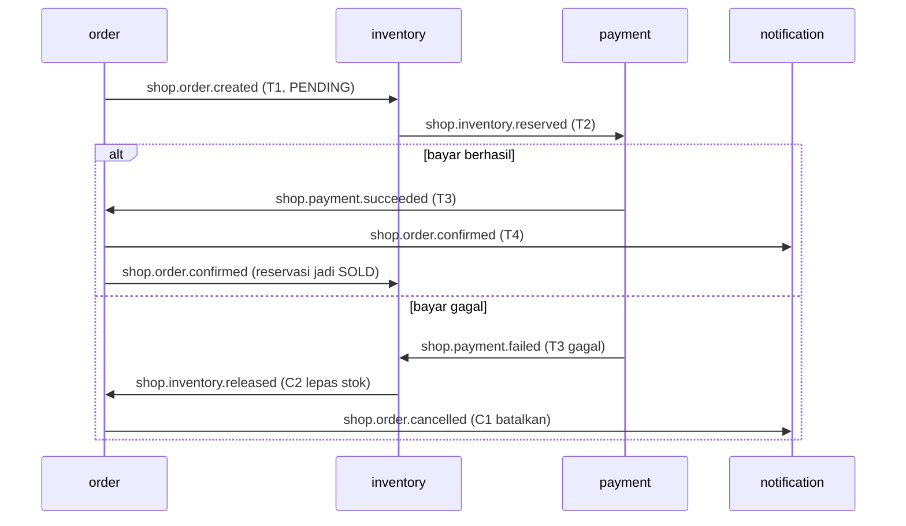

# Bab 5 · Toko Daring Microservices dan Messaging

Demo untuk **Bab 5 (Arsitektur Microservices dan Messaging)** buku *Sistem Terdistribusi dan Komputasi
Berkinerja Tinggi* dan **slide P05**. Demo ini menjalankan studi kasus "Merancang Toko Daring"
(subbab *Studi Kasus: Merancang Toko Daring*) sebagai sistem sungguhan: service Go terpisah dengan
database masing-masing, API gateway, load balancer, broker NATS, saga, dan pola ketahanan. Semua
konsep dapat diamati dari satu UI.

| Konsep di buku/slide | Wujud di demo |
|---|---|
| API gateway: routing, auth, rate limiting (subbab *Pintu Masuk dan Menemukan Layanan*) | APISIX standalone: route `/api/catalog`, `/api/orders`, `/api/monitor`; `key-auth`; `limit-count` 20 req/10 s; `request-id` |
| Load balancer, service stateless 2 replica | nginx membagi `order-1` dan `order-2` (round robin, passive health check, `proxy_next_upstream`) |
| Synchronous vs asynchronous | order → catalog dan order → inventory lewat REST (synchronous); sisa alur lewat event NATS JetStream |
| Queue dan publish-subscribe | durable consumer JetStream dipakai bersama 2 replica (pesan dibagi); lab: queue group vs subscriber biasa |
| Delivery semantics dan idempotency | lab core NATS (at-most-once) vs JetStream (at-least-once); fault "crash sebelum ack" → redelivery → tabel `processed_messages` mendeteksi duplikat; `Idempotency-Key` pada checkout |
| Event-driven architecture dan transactional outbox | setiap service menulis event ke tabel `outbox` dalam transaksi yang sama, relay menerbitkannya (`FOR UPDATE SKIP LOCKED`, `Nats-Msg-Id`) |
| Saga choreography dan compensating action | T1 buat pesanan → T2 pesan stok → T3 tagih → T4 konfirmasi; bila T3 gagal: C2 lepas stok → C1 batalkan |
| Timeout, retry, backoff + jitter, circuit breaker, fallback | order: timeout 300/500 ms, retry dengan full jitter, `sony/gobreaker` (closed/open/half-open) yang terlihat di UI; fallback precheck stok dan fallback pencarian ke Postgres |
| Database per service | satu instance Postgres, database `catalog`, `orders`, `inventory`, `payment`, `notification` |
| Pencarian (Elastic) | OpenSearch 2 node, index `products` 2 primary shard × 1 replica, pencarian fuzzy |
| Observability, distributed tracing | `X-Request-Id` dari APISIX diteruskan ke nginx, service, header NATS, dan event berikutnya; log JSON ke Loki |

## Arsitektur

```mermaid
flowchart LR
  B[Browser] --> UI[UI Next.js :50500]
  UI -->|REST + apikey| GW[APISIX :50501<br/>key-auth, limit-count, request-id]
  GW -->|/api/catalog| CAT[catalog]
  GW -->|/api/orders| LB[nginx order-lb :50502]
  GW -->|/api/monitor| MON[monitor]
  LB --> O1[order-1]
  LB --> O2[order-2]
  O1 & O2 -->|REST, timeout + breaker| CAT
  O1 & O2 -->|REST precheck, timeout + breaker| INV[inventory]
  CAT --> OS1[(OpenSearch-1)]
  CAT --> OS2[(OpenSearch-2)]
  subgraph NATS JetStream stream SHOP
    E((shop.*))
  end
  O1 & O2 -. outbox: order.created / confirmed / cancelled .-> E
  INV -. outbox: inventory.reserved / rejected / released .-> E
  PAY[payment] -. outbox: payment.succeeded / failed .-> E
  E -.-> INV & PAY & NOTIF[notification] & O1 & O2
  MON -. subscribe shop.> audit.> lab.> .-> E
  CAT & O1 & O2 & INV & PAY & NOTIF --> PG[(Postgres<br/>1 instance, DB per service)]
```

Alur saga (choreography, tanpa orchestrator):



Bila stok tidak cukup, inventory menerbitkan `shop.inventory.rejected` dan order langsung
dibatalkan (tidak ada yang perlu dikompensasi). Notifikasi diletakkan paling akhir karena surel yang
sudah terkirim tidak bisa ditarik kembali.

## Service dan image

| Service | Image | Peran |
|---|---|---|
| `catalog` | `sister-bab05-svc:dev` (Go 1.24, alpine 3.20) | produk, pencarian OpenSearch, fallback Postgres |
| `order-1`, `order-2` | idem | checkout, idempotency key, breaker, saga sisi order; port admin 8081 |
| `inventory` | idem | stok, reservasi (T2), kompensasi (C2), fault lambat/crash/dedup |
| `payment` | idem | penagihan (T3), fault gagal bayar |
| `notification` | idem | surel (langkah terakhir), penerima lab delivery semantics |
| `monitor` | idem | timeline event, status saga, health, breaker, fault injection, lab |
| `apisix` | `apache/apisix:3.11.0-debian` | API gateway standalone (tanpa etcd) |
| `order-lb` | `nginx:1.28-alpine` | load balancer 2 replica order |
| `nats` | `nats:2.10-alpine` | broker, JetStream di volume `natsdata` |
| `postgres` | `postgres:16-alpine` | satu instance, lima database |
| `opensearch-1`, `opensearch-2` | `opensearchproject/opensearch:2.19.1` | klaster pencarian 2 node, heap 512 MB per node |
| `ui` | `sister-bab05-ui:dev` (Next.js 15, node 20 alpine) | storefront dan dasbor |

Semua service Go dibangun menjadi **satu image** (`services/Dockerfile`); binary dipilih dengan
`command` di `compose.yaml`. Kode bersama (outbox, consumer idempotent, retry, logger) ada di
`services/platform/`.

**Catatan keamanan:** security plugin OpenSearch dimatikan (`DISABLE_SECURITY_PLUGIN=true`) hanya
untuk demo lokal agar tidak perlu sertifikat dan password. Jangan pakai pengaturan ini di produksi.
Port admin order (8081) dan route `/api/monitor/faults` adalah alat demo; di produksi route seperti
ini tidak diekspos lewat gateway publik. API key APISIX hanya disimpan di server UI (proxy
`/api/gw/...`), tidak dikirim ke browser.

## Port

| Port host | Isi |
|---|---|
| 50500 | UI (storefront + dasbor) |
| 50501 | APISIX gateway (`/api/...`, `/gw/ping`) |
| 50502 | nginx order-lb (langsung ke 2 replica order, tanpa gateway) |
| 50503 | NATS monitoring (`/varz`, `/jsz`, `/connz`) |
| 50504 | NATS client (untuk `nats` CLI) |
| 50505 | OpenSearch node-1 (REST) |
| 50506 | Postgres (`psql -h 127.0.0.1 -p 50506 -U sister orders`) |

Semua port diikat ke `${BIND_ADDR}` (default `127.0.0.1`).

## Menjalankan

```bash
cd bab05-microservices-messaging
cp .env.example .env          # di server lab: BIND_ADDR=10.100.21.22
docker compose up -d --build --wait
# buka http://127.0.0.1:50500
```

Start pertama butuh sekitar 1–2 menit karena OpenSearch membentuk klaster dan catalog mengisi index.
Kebutuhan memori sekitar 2,5 GB (dua node OpenSearch ±1,1 GB masing-masing, sisanya kecil).

Uji otomatis (build, start, 40-an pemeriksaan, lalu `down -v`):

```bash
bash uji.sh
```

## Skenario demo di kelas

Buka UI di proyektor. Bagian atas memperlihatkan **health** setiap komponen (gateway, nginx,
dua replica order, empat service, NATS, dua node OpenSearch, Postgres) beserta latency-nya.

1. **Pintu masuk dan pencarian (±5 menit).** Ketik `kopi`, lalu `raspbery` (salah ketik). Amati baris
   meta: `sumber opensearch`, node yang menjawab, `shard 2/2`, dan `request_id` yang dibuat APISIX.
   Pencarian fuzzy tetap menemukan Raspberry Pi. Lihat panel OpenSearch: primary (p, hijau tua) dan
   replica (r, garis putus) dari shard yang sama selalu berada di node berbeda.
   Kaitan teori: gateway sebagai satu pintu masuk; replikasi shard.
   *Variasi:* `docker compose stop opensearch-2` → status cluster menjadi `yellow`, replica
   unassigned, pencarian tetap jalan. `docker compose stop opensearch-1 opensearch-2` → sumber
   berubah menjadi `postgres-fallback` (fallback). Nyalakan lagi dengan `docker compose start ...`.

2. **Rate limiting dan auth (±3 menit).** Klik *Burst 30 pencarian*: hasilnya kira-kira 20 × HTTP 200
   dan 10 × HTTP 429. Pilih produk di keranjang lalu klik *Tanpa API key*: HTTP 401 dari APISIX,
   request tidak pernah sampai ke order.

3. **Saga sukses (±5 menit).** Tambah 1–2 produk (tombol +), kartu `valid`, klik *Checkout*. Hasil
   checkout menampilkan replica yang melayani (`order-1` atau `order-2`). Di panel saga, langkah
   T1 → T2 → T3 → T4 → notifikasi berubah hijau satu per satu. Di timeline, ikuti titik hijau
   (publish) dan panah ke service penerima, lalu titik biru (audit consumer). Klik id order untuk
   memfilter timeline; `rid` yang sama muncul di semua baris (distributed tracing sederhana).

4. **Saga gagal dan kompensasi (±5 menit).** Pilih kartu `ditolak bank` lalu checkout, atau set
   *Payment gagal 100%*. Amati: T3 ✗, lalu C2 (inventory melepas stok, angka stok kembali) dan C1
   (order CANCELLED). Diskusikan: kompensasi menambah perubahan baru, bukan `ROLLBACK`; status
   PENDING sempat terlihat (saga tidak memberi isolasi). Kembalikan payment ke 0%.

5. **Idempotency key (±2 menit).** Setelah checkout, klik *Kirim ulang (Idempotency-Key sama)*:
   respons `REPLAYED`, id order sama, tidak ada order baru di panel saga. Kaitan: retry aman hanya
   untuk operasi idempotent.

6. **Load balancer dan replica mati (±4 menit).** Klik *order-1: matikan*. Health order-1 menjadi
   kuning "DOWN (disuntik)" (port publik ditutup, nginx mendapat *connection refused*). Checkout
   beberapa kali: semua dilayani `order-2`, tanpa error. Event saga yang semestinya diproses order
   tetap jalan karena kedua replica berbagi durable consumer `order`. Hidupkan lagi.
   *Variasi nyata:* `docker compose stop order-2` lalu `docker compose start order-2`.

7. **Timeout, retry, circuit breaker (±6 menit).** Set *Inventory lambat 800 ms* (timeout order →
   inventory 300 ms, maksimal 2 percobaan dengan backoff + jitter). Klik *Checkout 5×*. Checkout
   pertama terasa lambat (±700 ms) dan precheck stok menjadi `fallback`. Setelah ≥4 panggilan
   dengan ≥50% gagal, breaker `→ inventory` pada replica itu berubah **OPEN** (merah): checkout
   berikutnya cepat lagi karena panggilan langsung ditolak tanpa menyentuh jaringan, dan saga tetap
   memastikan stok secara asynchronous. Perhatikan setiap replica punya breaker sendiri. Kembalikan
   delay ke 0, tunggu 10 detik: breaker menjadi **HALF-OPEN**, satu panggilan uji berhasil, lalu
   **CLOSED**. Timeline mencatat setiap transisi breaker.

8. **At-least-once dan consumer idempotent (±6 menit).** Aktifkan *crash sebelum ack*, lalu checkout.
   Di timeline muncul baris `crash` (inventory sudah commit, ack tidak dikirim), lima detik kemudian
   JetStream mengirim ulang (`pengiriman ke-2`) dan inventory mencatat `duplicate`: tabel
   `processed_messages` mendeteksinya sehingga stok hanya berkurang sekali. Sekarang matikan
   *consumer idempotent* (OFF) dan ulangi: stok berkurang **dua kali** untuk satu order. Inilah
   alasan consumer at-least-once wajib idempotent. Klik *Reset semua fault* dan *Reset stok*.

9. **Lab delivery semantics (±5 menit).** Panel lab: klik *Kirim 10 via core NATS* → worker A dan B
   membagi pesan (queue group), `audit-log` menerima 10 (fan-out). Klik *penerima offline*, kirim 10
   via core dan 10 via JetStream: core **hilang** (at-most-once, tidak ada yang menyimpan), JetStream
   menunggu di stream. Klik *online*: 10 pesan JetStream langsung diterima.

10. **Log di Grafana (±3 menit).** Salin `request_id` dari hasil checkout dan cari di Loki (lihat
    bawah): baris log APISIX, nginx, order, inventory, payment, dan notification untuk satu request.

## Melihat log di Grafana

Nyalakan observability bersama sekali: `docker compose -f ../shared/observability/compose.yaml up -d`,
lalu buka Grafana di port 50000 → Explore → Loki. Contoh query:

```logql
{compose_project="sister-bab05"} | json
{compose_project="sister-bab05"} | json | request_id="<tempel request_id>"
{compose_project="sister-bab05", compose_service="inventory"} |= "duplikat"
{compose_project="sister-bab05"} | json | level="warn"
```

Dashboard khusus bab ini ada di `grafana/bab05-toko-daring.json` (event outbox per subject,
duplikat/crash di consumer, request per service, warning, dan log satu request lewat variabel
`request_id`). Dashboard ini otomatis muncul di Grafana, folder "Sister Demo", setelah stack
observability dijalankan; dashboard bersama "Log per demo" juga bisa memfilter `request_id`.

Semua service Go menulis log JSON satu baris (`time`, `level`, `msg`, `service`, `replica`,
`request_id`, `order_id`, `subject`). APISIX dan nginx juga memakai format akses JSON dengan
`request_id`.

## Struktur folder

```
bab05-microservices-messaging/
  compose.yaml, .env.example, uji.sh
  apisix/      config.yaml (standalone), apisix.yaml.tpl (route, consumer), start.sh
  nginx/       nginx.conf (upstream 2 replica order)
  postgres/    01-databases.sql (database per service)
  services/    satu modul Go: platform/ (outbox, consumer, retry), catalog/, order/, inventory/,
               payment/, notification/, monitor/, Dockerfile
  ui/          Next.js (storefront, saga, timeline, breaker, fault, lab, OpenSearch)
```

Unit test: `cd services && go test ./...` (backoff full jitter, transisi saga order, rekonstruksi
saga di monitor, keputusan payment).

## Membersihkan

```bash
docker compose down -v          # hapus container dan volume milik sister-bab05 saja
docker builder prune -f         # buang build cache
# opsional: docker image rm sister-bab05-svc:dev sister-bab05-ui:dev
```
