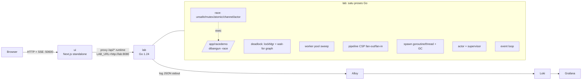

# Bab 6: Concurrency Lab (Concurrency dan Runtime)

Demo untuk **Bab 6 "Concurrency dan Runtime"** buku *Sistem Terdistribusi dan Komputasi Berkinerja
Tinggi* dan **slide P06** (`P06-concurrency.tex`). Satu service Go menjalankan eksperimen concurrency
sungguhan (goroutine, channel, `sync.Mutex`, `sync/atomic`, `runtime`), dan UI Next.js menampilkan
hasilnya secara live lewat Server-Sent Events (SSE).

| Tab di UI | Eksperimen | Subbab buku / bagian slide P06 |
|---|---|---|
| 1 · Race condition | Penghitung bersama dengan 5 model: `unsafe`, `mutex`, `atomic`, `channel` (satu pemilik), `actor`; sebaran hasil, waktu median, dan keluaran **race detector** (`go build -race`) | "Thread dan Lock: Race Condition", studi kasus "Satu Soal, Tiga Model" / slide "Thread + lock", "Satu soal, tiga model" |
| 2 · Deadlock | Transfer antarrekening dengan dua lock; **graf alokasi resource dan wait-for graph** live, deteksi siklus, empat strategi: naif, urutan lock global, `tryLock` + timeout + jitter, `tryLock` tanpa jitter (livelock) | "Deadlock" (syarat Coffman, livelock, starvation) |
| 3 · Worker pool | Sweep jumlah worker × `GOMAXPROCS` untuk job CPU-bound dan I/O-bound: throughput, latency p95, waktu layanan | "Thread Pool dan Virtual Thread", "Worker pool" |
| 4 · CSP pipeline | generator → `jobs` → N worker (fan-out) → channel per worker → merge (fan-in) → `results` → sink; isi buffer, laju, persentase generator tertahan (**backpressure**), knob live | "CSP di Go: Goroutine dan Channel", "Backpressure dan Reactive Streams" |
| 5 · Goroutine vs thread | Membuat ratusan ribu goroutine parkir vs ribuan thread OS (`runtime.LockOSThread`); biaya per unit (stack, RSS, virtual, waktu buat); metrik runtime live (goroutine, thread, heap, stack, GC pause); beban GC | "CSP di Go" (goroutine murah), "Go: scheduler M:N dengan model G-M-P" |
| 6 · Actor & event loop | (a) Actor rekening dengan mailbox, actor "panas", pesan racun + supervisor ("let it crash"); (b) event loop satu goroutine, **event loop lag** saat callback berat vs offload ke worker | "Actor Model" (Erlang/BEAM, Akka/Pekko), "Event Loop dan async/await", "Ringkasan model runtime" |

Metrik runtime (CPU, `GOMAXPROCS`, goroutine, thread OS, heap, stack, RSS, GC) tampil di baris atas
setiap tab, sehingga efek setiap eksperimen pada runtime terlihat langsung.

## Arsitektur



- `lab` (`services/lab`): Go 1.24, `log/slog` JSON. Biner kedua `racedemo` dibangun dengan
  `CGO_ENABLED=1 go build -race` di stage build (alpine + gcc), lalu dijalankan oleh endpoint
  `/api/race/detector` agar laporan `WARNING: DATA RACE` asli tampil di UI.
- `ui` (`ui/`): Next.js 15 (App Router, TypeScript, `output: "standalone"`). Route handler
  `app/api/[...path]/route.ts` meneruskan semua `/api/*` ke `lab` saat runtime (stream SSE ikut
  diteruskan; kompresi Next dimatikan agar SSE tidak tertahan). Grafik ditulis sebagai SVG tanpa
  library tambahan.
- Tanpa database: semua eksperimen bersifat sementara di memori proses.
- Container `lab` dibatasi `cpuset: ${LAB_CPUSET}` (bawaan `0-3`). Go 1.24 membaca afinitas CPU ini,
  sehingga `NumCPU` dan `GOMAXPROCS` bawaan = 4 dan hasil worker pool konsisten di laptop maupun
  server lab yang punya banyak core.

## Menjalankan

```bash
cd bab06-concurrency-runtime
cp .env.example .env          # BIND_ADDR=127.0.0.1; di server lab: 10.100.21.22
docker compose up -d --build
# buka http://127.0.0.1:50600
```

Laptop dengan 2 core: ubah `LAB_CPUSET=0-1` di `.env`.

Uji otomatis (build, up, cek semua eksperimen termasuk SSE lewat proxy UI, lalu `down -v`):

```bash
bash uji.sh
```

Pengembangan lokal tanpa Docker: `cd services/lab && LAB_ADDR=127.0.0.1:50601 go run .`, lalu
`cd ui && LAB_URL=http://127.0.0.1:50601 npm run dev`. Endpoint race detector butuh biner
`racedemo` (`CGO_ENABLED=1 go build -race -o /tmp/racedemo ./cmd/racedemo`, lalu
`RACEDEMO_BIN=/tmp/racedemo`).

## Port

| Port host | Service | Keterangan |
|---|---|---|
| `${BIND_ADDR}:50600` | ui | UI Concurrency Lab (Next.js) |
| `${BIND_ADDR}:50601` | lab | API Go langsung (untuk `curl`); UI tidak membutuhkannya |

## Skenario demo di kelas (±45 menit)

**Persiapan.** `docker compose up -d --build`, buka `http://<BIND_ADDR>:50600`, proyeksikan. Baris
metrik di atas menunjukkan 4 CPU, `GOMAXPROCS` 4, sekitar 10 goroutine.

1. **Race condition (tab 1, ±8 menit).**
   - Biarkan G = 1000, N = 1000, percobaan = 5. Klik **Jalankan semua model**.
   - Amati: baris `unsafe` menghasilkan angka berbeda tiap percobaan dan jauh di bawah 1.000.000
     (kolom "hilang" merah). Empat model lain selalu tepat.
   - Hubungkan ke tabel interleaving di buku: `n++` = baca, tambah, tulis. Dua goroutine membaca 5,
     keduanya menulis 6.
   - Bandingkan median waktu: `unsafe` tercepat tetapi salah; `atomic` < `mutex` < `channel`/`actor`.
     Ini bahan diskusi "periksa kebenaran dulu, baru kecepatan" dan "operasi sekecil tambah satu
     terlalu halus untuk channel dan actor".
   - Klik **Jalankan unsafe dengan -race**: terminal menampilkan `WARNING: DATA RACE` dengan alamat
     memori, goroutine pembaca dan penulis, serta exit code 66. Klik **atomic dengan -race**: bersih.
     Tekankan: race detector menemukan race walaupun hasil kebetulan benar.
   - Coba G = 2 dan N = 1000: race jarang terlihat. "Seratus kali uji yang lulus hanya berarti
     interleaving buruk belum terjadi."

2. **Deadlock (tab 2, ±8 menit).**
   - Strategi **Naif**, 2 thread, 300 ms. Klik **Mulai**. Di graf, T1 memegang rekA (panah abu-abu)
     dan menunggu rekB (panah merah putus-putus); T2 sebaliknya. Wait-for graph menunjukkan
     `T1 → T2, T2 → T1` dan lencana **siklus**. Setelah 1,5 detik detektor menyatakan DEADLOCK,
     lalu membatalkan thread (seperti DBMS memilih victim). Transfer selesai 0/6.
   - Ganti ke 3 thread: siklus T1 → T2 → T3 → T1.
   - **Urutan lock global**: semua transfer selesai, total saldo tetap 3000. Syarat circular wait
     dipatahkan.
   - **tryLock + timeout + jitter**: ada retry di log ("gagal dapat ..., lepas ..., mundur ... ms"),
     tetapi selesai. Syarat hold and wait dipatahkan.
   - **tryLock tanpa jitter**: kedua thread terus mundur dengan irama yang sama; retry menumpuk dan
     status berakhir livelock atau sangat lambat. Hubungkan ke jitter di Bab 5.

3. **Worker pool (tab 3, ±7 menit).**
   - Jenis **CPU-bound**, 200 job × 2 ms. Klik **Jalankan sweep**. Garis `GOMAXPROCS=1` datar:
     menambah worker tidak menambah throughput. Garis `GOMAXPROCS=4` naik sampai 4 worker lalu datar.
     Grafik waktu layanan memperlihatkan job makin lama bila worker > GOMAXPROCS (disela dan antre P).
   - Ganti ke **I/O-bound**, 200 job × 10 ms: throughput naik hampir linear sampai 64–128 worker,
     bahkan dengan `GOMAXPROCS=1`, karena goroutine yang menunggu diparkir dan P bebas
     (netpoller/timer). Hubungkan ke hitungan buku: 10.000 tugas × 1 detik dengan 8 thread = 1.250 detik.
   - Perhatikan baris metrik atas: `GOMAXPROCS` berubah selama sweep.

4. **CSP pipeline dan backpressure (tab 4, ±8 menit).**
   - Worker 3, buffer 4. Klik **Mulai pipeline**. Kotak worker menyala bergantian; buffer `jobs`
     hampir kosong; laju generator = laju sink.
   - Geser **kerja di sink** ke 100 ms. Dalam satu-dua detik `results`, `out1..3`, lalu `jobs` penuh;
     "generator tertahan" naik mendekati 100%; laju generator turun ke ±10/s mengikuti sink. Inilah
     backpressure: konsumen menentukan laju tanpa protokol `request(n)` eksplisit.
   - Kembalikan sink ke 10 ms, naikkan **kerja per item di worker** ke 300 ms: sekarang worker yang
     menjadi bottleneck (kapasitas ≈ 3 × 1000/300 = 10/s). Hentikan, ubah worker ke 8, mulai lagi:
     throughput naik (fan-out).
   - Ulangi dengan buffer 64: generator tertahan lebih lambat, tetapi umur item (latency) di sink jauh
     lebih tinggi. Buffer besar menyembunyikan masalah dan menambah latency.

5. **Goroutine vs thread OS (tab 5, ±7 menit).**
   - Klik **Buat goroutine parkir** (100.000). Tabel: sekitar 2–3 KB stack/RSS per goroutine, beberapa
     mikrodetik per goroutine; thread OS proses hampir tidak bertambah. Grafik goroutine melonjak.
   - Klik **Buat thread OS** (2000). Thread OS proses naik ke ±2000; RSS per unit sekitar 20 KB
     (8× goroutine) dan waktu buat per unit sekitar 10× lebih lama. Kolom virtual bisa nol karena biner Go
     tanpa cgo mengalokasikan stack thread (g0) dari memori runtime sendiri; thread pthread di C/Java
     memesan stack 1–8 MB per thread.
   - Hubungkan ke model G-M-P: goroutine adalah G, thread adalah M; `LockOSThread` memaksa 1 G = 1 M.
   - Klik **Lepaskan semua**, lalu **Jalankan beban GC**: grafik heap bergerigi (sawtooth), titik jeda GC
     muncul dalam puluhan sampai ratusan µs. Diskusikan GC concurrent vs jeda stop-the-world.

6. **Actor dan event loop (tab 6, ±7 menit).**
   - Actor: mulai dengan 4 actor, 100 pesan/s, 5 ms. Mailbox nyaris kosong. Centang **actor 0 panas**
     dan geser proses per pesan ke 20 ms (kapasitas 50/s per actor): mailbox actor 0 menumpuk,
     actor lain tetap ringan. Tabel menjaga invarian "terkirim = saldo + isi mailbox" tanpa lock.
   - Klik **racun** pada salah satu actor: log menunjukkan crash dan restart oleh supervisor, kolom
     restart bertambah, actor lanjut memproses ("let it crash").
   - Event loop: klik **Mulai event loop**. Lag timer < 2 ms. Klik **Jalankan DI loop (blocking)**
     dengan 400 ms: lag dan latency request melonjak ±400 ms. Klik **Pindah ke worker (offload)**:
     lag tetap rendah. Hubungkan ke Node.js/libuv dan "satu tugas berat membekukan semua".

**Penutup.** Kembali ke tabel perbandingan model di akhir bab: thread + lock (race, deadlock),
goroutine + channel (goroutine leak, channel macet), actor (mailbox menumpuk), event loop (lag).
Semua risiko itu baru saja terlihat di layar.

## Log di Grafana

1. Jalankan observability bersama sekali: `docker compose -f shared/observability/compose.yaml up -d`.
2. Buka Grafana `http://<BIND_ADDR>:50000` → Explore → datasource Loki.
3. Query:
   - `{compose_project="sister-bab06"}` untuk semua log bab ini;
   - `{compose_project="sister-bab06", compose_service="lab"} | json | msg="deadlock terdeteksi"`;
   - `{compose_project="sister-bab06", compose_service="lab"} | json | msg="actor crash"`;
   - `{compose_project="sister-bab06", compose_service="lab"} | json | request_id="<id>"` untuk menelusuri
     satu request (header `X-Request-Id`).

Service `lab` menulis log JSON satu baris (`time`, `level`, `msg`, `service`, `request_id`, dan field
eksperimen seperti `strategy`, `cycle`, `session`).

## API ringkas

| Method | Path | Isi |
|---|---|---|
| GET | `/api/health` | status + metrik runtime |
| POST | `/api/race` | `{goroutines, iters, trials, modes?}` → hasil per model |
| POST | `/api/race/detector` | `{mode}` → keluaran biner `-race` |
| GET (SSE) | `/api/deadlock/stream?strategy=naive\|ordered\|trylock\|trylock-nojitter&threads=2..4&hold_ms=` | event `state`, `log`, `detected`, `done` |
| POST | `/api/pool/sweep` | `{kind: cpu\|io, jobs, job_ms, workers[], gomaxprocs[]}` |
| GET (SSE) | `/api/pipeline/stream?workers=&buffer=&produce_ms=&work_ms=&sink_ms=` | event `start` (session), `state`, `done` |
| POST | `/api/spawn`, `/api/spawn/release`, `/api/gc/churn` | biaya goroutine/thread, beban GC |
| GET / SSE | `/api/metrics`, `/api/metrics/stream` | metrik runtime |
| GET (SSE) | `/api/actor/stream`, `/api/eventloop/stream` | actor dan event loop |
| POST | `/api/session/{id}?knob=nilai` | ubah knob live (`produce_ms`, `work_ms`, `sink_ms`, `rate`, `process_ms`, `hot`) atau aksi (`poison`, `block`, `offload`) |

Eksperimen berat (race, pool, spawn, GC) dijalankan satu per satu; bila bertabrakan, API menjawab
409 karena `GOMAXPROCS` dan jumlah goroutine berlaku global untuk satu proses.

## Membersihkan

```bash
docker compose down -v
docker builder prune -f
# opsional, hapus image bab ini saja:
docker image rm sister-bab06-lab:1.0 sister-bab06-ui:1.0
```

## Catatan

- Mode `unsafe` sengaja mengandung data race. Ia hanya dipakai untuk demonstrasi; unit test tidak
  menguji mode itu (`go test ./...` di `services/lab`).
- Angka mutlak (µs, MB, job/s) bergantung pada mesin dan beban server; yang dibahas di kelas adalah
  bentuk kurva dan perbandingannya.
- Mode "thread OS" membatasi 5000 thread dan mode goroutine 500.000 (batas memori container 2 GB).
