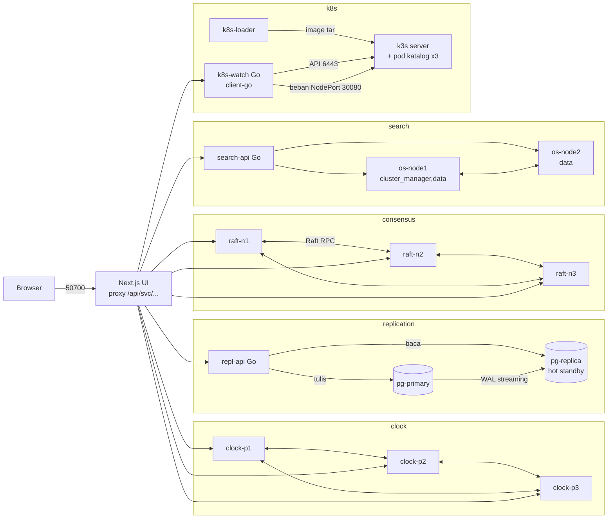

# Bab 7: Replikasi, Konsistensi, Kubernetes

Demo kelas untuk **Bab 7 buku Sistem Terdistribusi (Replikasi, Konsistensi, Kubernetes)** dan
**slide P07**. Lima demo, masing-masing satu *compose profile*, dengan satu UI Next.js di
`http://127.0.0.1:50700` (halaman per profile).

| Profile | Halaman UI | Isi | Subbab buku / bagian slide P07 |
|---|---|---|---|
| `clock` | `/clock` | 3 proses Go saling mengirim pesan; diagram ruang-waktu Lamport clock dan vector clock, happens-before vs concurrent, jam dinding yang digeser | Waktu dan Urutan (Lamport clock, vector clock) |
| `replication` | `/replication` | PostgreSQL 16 primary + replica (streaming replication); replication lag, anomali read-your-writes, skenario Ani dan Budi, async vs sync | Replication (leader-follower), Consistency Model |
| `consensus` | `/consensus` | Kluster Raft 3 node (`hashicorp/raft`); leader, term, replicated log, commit index, crash leader dan election | Consensus dengan Raft |
| `search` | `/search` | OpenSearch 2 node, index 3 shard x 1 replica; alokasi shard per node, status yellow, replica dipromosikan | Replication, Data Partitioning |
| `k8s` | `/k8s` | k3s di dalam container; Deployment Go + Service, self-healing, scaling, rolling update, readinessProbe, beban 5 request/detik | Container dan Kubernetes, Praktikum "matikan pod, ukur waktu pulih" |

## Arsitektur



Catatan desain:

- Semua service Go ada di satu modul (`services/`) dan dibangun menjadi **satu image**
  `sister-bab07-go:dev` (binary `clocknode`, `raftnode`, `replapi`, `searchapi`, `k8swatch`) agar
  disk hemat. Log semuanya JSON satu baris (`log/slog`; log internal Raft memakai `hclog` JSON).
- UI memanggil service lewat route `/api/<svc>/...` (proxy tipis). Bila service tidak menjawab,
  proxy mengembalikan `503 {down: true}` dan halaman menampilkan perintah untuk menyalakan profile.
- Image aplikasi `katalog` untuk k3s dibuat saat build oleh `mkimage` (format `docker save`, tanpa
  Docker daemon), disalin `k8s-loader` ke folder auto-import k3s. Tidak perlu registry.
- **kubeconfig** ditulis k3s saat runtime ke volume `k3s-kube` dan hanya dibaca `k8s-watch`;
  tidak ada di repo (`kubeconfig*.yaml` ada di `.gitignore`).
- **Security plugin OpenSearch dimatikan** (`DISABLE_SECURITY_PLUGIN=true`) hanya untuk demo lokal;
  port terikat ke `BIND_ADDR`. Jangan dipakai seperti ini di jaringan terbuka.
- Replica PostgreSQL dijalankan dengan `fsync=off` agar cepat dibangun ulang; hanya untuk demo.

## Cara menjalankan

```bash
cd bab07-replikasi-konsistensi-kubernetes
cp .env.example .env            # BIND_ADDR=127.0.0.1; di server lab 10.100.21.22
docker compose --profile clock up -d --build
# buka http://127.0.0.1:50700/clock
docker compose --profile clock down -v
```

Ganti `clock` dengan `replication`, `consensus`, `search`, atau `k8s`. Beberapa profile boleh
dinyalakan sekaligus (`--profile clock --profile consensus`), tetapi `search` (2 x OpenSearch, heap
512 MB per node, sekitar 2,5 GB RAM) dan `k8s` (k3s, sekitar 600 MB RAM) sebaiknya satu per satu.

Waktu start kira-kira: `clock` dan `consensus` beberapa detik, `replication` 20-40 detik
(pg_basebackup), `search` 40-90 detik, `k8s` 60-120 detik (k3s start, menarik image `pause`
dari Docker Hub, lalu men-deploy katalog). Profile `k8s` butuh akses internet sekali untuk image
`rancher/k3s` dan `rancher/mirrored-pause`.

Uji otomatis (menyalakan, memeriksa, dan mematikan setiap profile berurutan):

```bash
bash uji.sh                  # semua profile
bash uji.sh clock consensus  # sebagian
```

## Skenario demo di kelas

### 1. Lamport clock dan vector clock (`/clock`, sekitar 10 menit)

1. Klik **Skenario gambar buku**. Diagram ruang-waktu menggambar ulang gambar Lamport clock di buku:
   P1 lokal, P1 kirim ke P2, P2 kirim ke P3. Pilih label **Lamport clock**: nilainya 1, 2, 3 di P1;
   1, 3, 4 di P2; 1, 5, 6 di P3. Tunjukkan aturan `C <- max(C, t) + 1` pada titik terima.
2. Klik kejadian ketiga P1 (C=3) lalu kejadian pertama P3 (C=1). Panel **Bandingkan dua kejadian**
   menyatakan keduanya **concurrent** dan memberi peringatan bahwa Lamport 3 vs 1 tampak berurutan:
   bila a → b maka C(a) < C(b), tetapi kebalikannya tidak berlaku.
3. Ganti label ke **vector clock**. Bandingkan kirim P1 `[2,0,0]` dengan terima P3 `[2,3,2]`:
   happens-before (lewat P2, transitif).
4. Klik **Pesan bersilangan**: P1 dan P3 saling mengirim dengan delay 1,5 detik sehingga pesan
   bersilangan di jalan (garis putus-putus selama di jalan). Kedua kejadian kirim concurrent.
5. Lihat kartu **Jam di tiap node**: jam dinding P2 mundur 1,5 detik dan P3 maju 0,7 detik.
   Kirim pesan P1 → P2: daftar **Urutan menurut jam dinding** menandai merah penerimaan yang
   "terjadi sebelum" pengirimannya. Ini subbab "Jam di tiap mesin berbohong sedikit-sedikit".
   Daftar **Total order dari Lamport** selalu konsisten dengan sebab-akibat.

### 2. Replication dan consistency model (`/replication`, sekitar 15 menit)

1. Kartu **Primary** dan **Replica** memperlihatkan WAL LSN, receive/replay LSN, dan status
   `streaming / async` dari `pg_stat_replication`. Ini leader-follower di buku.
2. Pastikan mode **asynchronous** dan apply delay **3000 ms** (bawaan 2000 ms dari `.env`).
   Klik **Ani menulis, lalu Ani dan Budi membaca**. Tabel hasil menyamai gambar Ani-Budi di buku:
   - strong (baca primary): Ani dan Budi 12rb;
   - read-your-writes: Ani 12rb (klien mengingat LSN tulisan, replica belum sampai, dialihkan ke
     primary), Budi 10rb dari replica;
   - eventual (baca replica): keduanya 10rb (usang). Baris Ani adalah **anomali read-your-writes**.
3. Grafik **Konvergensi replica** memperlihatkan nilai di replica berubah ke 12rb sekitar 3 detik
   kemudian: eventual consistency. Grafik **replay lag** di kartu kanan ikut naik.
4. Pilih apply delay **1000 ms** lalu mode **synchronous (remote_apply)**, ulangi skenario. Commit
   di primary kini sekitar 1000 ms (menunggu replica menerapkan), tetapi semua bacaan dari replica
   segar. Diskusikan trade-off latency vs consistency (PACELC: saat jaringan sehat, pilih latency
   atau consistency).
5. (Opsional, terminal) Dalam mode synchronous, `docker compose --profile replication stop pg-replica` lalu jalankan skenario:
   tulisan macet sampai timeout, seperti disebut buku ("bila follower mati, tulisan macet").
   `docker compose --profile replication start pg-replica` lalu kembalikan ke mode asynchronous.

### 3. Consensus dengan Raft (`/consensus`, sekitar 10 menit)

1. Tiga kartu node menampilkan peran (follower/candidate/leader), term, commit index, dan state
   machine. Riwayat peran di bawah memperlihatkan election awal (candidate lalu leader).
2. Tulis `harga=12000` beberapa kali. Permintaan dikirim ke follower dan diteruskan ke leader;
   pesan di bawah tombol menyebut index entri dan waktu commit. Tabel **Replicated log** menunjukkan
   entri yang sama dengan index dan term yang sama di ketiga node, bergaris tebal bila sudah commit.
3. Klik **Matikan leader**. Dalam 1-3 detik salah satu follower menjadi candidate, lalu leader dengan
   **term lebih tinggi** (warna entri `noop` term baru di log). Badge kluster: 2/3 node hidup, quorum
   terpenuhi; tulis lagi dan tetap berhasil.
4. Matikan satu node lagi: 1/3 hidup, quorum tidak terpenuhi, tulisan gagal ("belum ada leader").
   Hubungkan dengan "Mengapa jumlah node selalu ganjil?".
5. Hidupkan node yang mati. Ia kembali sebagai follower dari log di disk dan mengejar entri yang
   tertinggal (kolom kosong di tabel log terisi).

### 4. Shard dan replica OpenSearch (`/search`, sekitar 10 menit)

1. Tunggu status **green**. Kartu node memperlihatkan P0-P2 dan R0-R2 tersebar: primary dan replica
   shard yang sama tidak pernah di node yang sama. Tabel di bawahnya menyebut lokasi tiap shard.
2. Di terminal: `docker compose --profile search stop os-node2`. Dalam beberapa detik status menjadi **yellow**,
   kotak os-node2 bertanda "mati / keluar", replica yang kehilangan pasangan ada di kotak UNASSIGNED,
   dan **Kejadian** mencatat "shard N: primary pindah dari os-node2 ke os-node1 (replica dipromosikan)".
3. Klik **Cari nama**: hasil tetap lengkap (60 dokumen tetap ada) karena setiap shard masih punya
   satu salinan.
4. `docker compose --profile search start os-node2`: replica dibangun ulang (kotak kuning initializing), lalu green.
5. (Diskusi) `docker compose --profile search stop os-node1` membuat kluster tidak tersedia karena os-node1 satu-satunya
   cluster manager. Kluster produksi memakai tiga node cluster-manager-eligible agar mayoritas tetap ada.
   Jalankan lagi dengan `docker compose --profile search start os-node1`.

### 5. Kubernetes dengan k3s (`/k8s`, sekitar 15 menit)

1. Tunggu 3 pod **Ready**. Bilah **Beban ke Service** menunjukkan 5 request/detik ke Service NodePort
   (setara pod `beban` di praktikum buku, dari dalam kluster, bukan `port-forward`); warna batang
   adalah versi pod yang menjawab, dan kartu pod menghitung request per pod (load balancing Service).
2. Klik **Hapus satu pod**. Pod lama Terminating, ReplicaSet controller membuat pod baru (Running,
   belum Ready selama 3 detik pemanasan, lalu Ready). **Kejadian** mencatat waktu pulih
   ("self-healing selesai ... X detik"). Request tetap hijau: desired state vs actual state dan
   control loop.
3. **Scale** ke 1, hapus pod: ada jeda tanpa pod Ready dan request gagal (merah). Scale ke 3, ulangi:
   tidak ada yang gagal. Ini variasi 1 praktikum buku.
4. **readinessProbe: matikan** (terjadi rolling update), lalu hapus pod lagi: pod baru langsung
   dianggap Ready padahal masih pemanasan, sehingga sebagian request gagal (`connection refused`).
   Nyalakan lagi readinessProbe. Ini variasi 2 praktikum buku.
5. **Rolling update ke v2**: tabel ReplicaSet menunjukkan revisi baru naik satu per satu
   (`maxSurge=1`, `maxUnavailable=0`) dan revisi lama turun; bilah beban berubah hijau ke biru tanpa
   batang merah.

## Port

Semua port terikat ke `${BIND_ADDR}` (bawaan `127.0.0.1`).

| Port | Service | Keterangan |
|---|---|---|
| 50700 | `ui` | UI Next.js (semua profile) |
| 50710-50712 | `clock-p1..p3` | API proses P1-P3 (`/state`, `/local`, `/send`) |
| 50720 | `pg-primary` | PostgreSQL primary (user `postgres`, password dari `.env`) |
| 50721 | `pg-replica` | PostgreSQL replica (hot standby, read-only) |
| 50722 | `repl-api` | API klien Go (`/status`, `/scenario`, `/mode`, `/delay`) |
| 50730-50732 | `raft-n1..n3` | API node Raft (`/status`, `/set`, `/admin/crash`, `/admin/restart`) |
| 50740 | `os-node1` | OpenSearch REST node 1 (cluster manager + data) |
| 50741 | `os-node2` | OpenSearch REST node 2 (data) |
| 50742 | `search-api` | API klien Go (`/cluster`, `/search`) |
| 50750 | `k3s` | Kubernetes API server (TLS) |
| 50751 | `k8s-watch` | API client-go (`/status`, `/action`) |

## Melihat log di Grafana

Jalankan observability bersama sekali dari root repo:
`docker compose -f shared/observability/compose.yaml up -d`, lalu buka Grafana
`http://127.0.0.1:50000` → Explore → Loki. Contoh query:

```logql
{compose_project="sister-bab07"}
{compose_project="sister-bab07", compose_service=~"raft-n."} |= "state"
{compose_project="sister-bab07", compose_service="repl-api"} | json | msg="skenario ani-budi"
{compose_project="sister-bab07", compose_service="search-api"} | json | msg="cluster event"
{compose_project="sister-bab07", compose_service="k8s-watch"} | json | kind="pulih"
```

Log Raft internal (`hclog`) memakai field `@message` dan `@level`; log aplikasi memakai `msg`,
`level`, `service`, dan `request_id`.

Untuk melihat kluster k3s dengan `kubectl` dari host (opsional):

```bash
docker compose --profile k8s exec k3s kubectl get pods -l app=katalog -o wide -w
docker compose --profile k8s exec k3s kubectl get events --sort-by=.lastTimestamp
```

## Membersihkan

```bash
docker compose --profile clock --profile replication --profile consensus \
  --profile search --profile k8s down -v
docker builder prune -f
# opsional, bila image demo tidak dipakai lagi:
docker image rm sister-bab07-go:dev sister-bab07-ui:dev
```

`down -v` juga menghapus volume k3s (termasuk kubeconfig dan image di dalam k3s) dan data
PostgreSQL/OpenSearch/Raft milik project `sister-bab07` saja.
