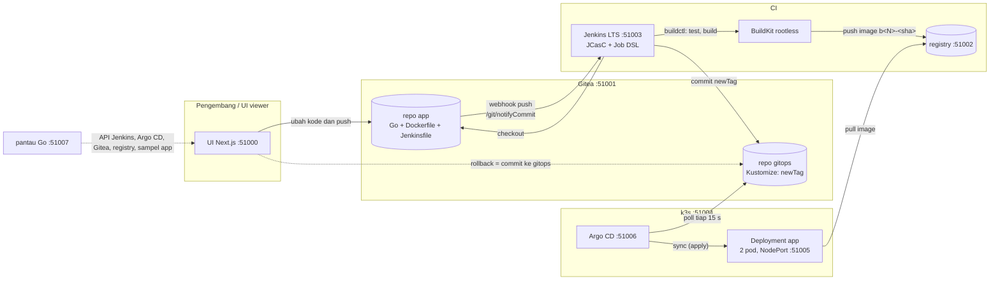
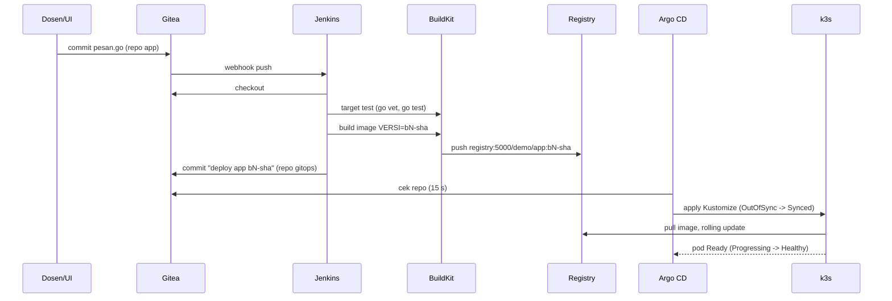

# Demo CI/CD: Jenkins + Argo CD (GitOps) di k3s

Demo lintas bab. Satu commit kecil di repo kode berjalan sampai menjadi pod baru di Kubernetes:
**Gitea → Jenkins (test, build image, push) → registry lokal → repo gitops → Argo CD → k3s**.
Semuanya berjalan lokal dengan Docker Compose, tanpa layanan cloud dan tanpa langkah klik manual
saat instalasi.

## Tujuan dan kaitan ke materi

| Materi | Yang diperlihatkan demo |
|---|---|
| **Bab 7 "Container dan Kubernetes", slide P07** (subbab *Desired state dan control loop*, *Deployment, probe, dan Service*) | Deployment 2 replica dengan readinessProbe dan strategi RollingUpdate (`maxSurge 1`, `maxUnavailable 0`); Service NodePort; saat versi berganti, panel "Versi yang sedang melayani request" menampilkan dua versi bersamaan, lalu versi lama habis. |
| **Bab 7, paragraf GitOps dan Tabel "Implementasi platform Kubernetes"** (baris *Packaging dan deploy: Helm atau Kustomize + Argo CD*) | Desired state disimpan di Git (repo `gitops`, Kustomize). Argo CD adalah controller yang menjalankan Algoritma *reconciliation loop* satu tingkat di atas Deployment controller: membandingkan Git (desired) dengan cluster (actual), lalu menyamakannya. Tombol *drift* memperlihatkan self-healing pada tingkat GitOps. |
| **Bab 5 Microservices, Tabel perbandingan arsitektur** (baris *Kebutuhan operasi: CI/CD, tracing, orkestrasi*) | Setiap service microservices di-deploy mandiri; tanpa pipeline otomatis, biaya operasinya tidak tertanggung. Pipeline di sini adalah satu "jalur deploy" per service. |
| Bab 5, idempotency | `kubectl apply`/sync Argo CD bersifat idempotent: sync berulang pada state yang sama tidak mengubah apa pun. |

Pemisahan CI dan CD juga menjadi pelajaran: **Jenkins tidak punya akses ke cluster**. Tahap terakhirnya hanya
commit tag image ke repo gitops. Argo CD yang berada di dalam cluster menarik (*pull*) perubahan itu.

## Arsitektur





### Komponen dan versi (dipin)

| Service | Image | Peran |
|---|---|---|
| `gitea` | `gitea/gitea:28.3.0-rootless` | Git server lokal, repo `demo/app` dan `demo/gitops` |
| `gitea-admin` | (sama) | sekali jalan: membuat user admin lewat CLI Gitea |
| `jenkins` | `jenkins/jenkins:2.580.2-lts-jdk21` + 66 plugin dipin (`jenkins/plugins.txt`) + `buildctl` | CI; konfigurasi penuh dari `jenkins/casc.yaml` (JCasC + Job DSL) |
| `buildkitd` | `moby/buildkit:v0.34.2-rootless` | membangun image tanpa Docker socket |
| `registry` | `registry:3.1.1` | registry image lokal (HTTP) |
| `k3s` | `rancher/k3s:v1.32.3-k3s1` (sama dengan Bab 7) | cluster Kubernetes satu node |
| Argo CD (di dalam k3s) | `quay.io/argoproj/argocd:v3.4.13`, `redis:8.2.3-alpine` | CD/GitOps; manifest resmi dicek sha256 |
| `init` | `alpine:3.20` + kubectl (dari image k3s) | sekali jalan: isi Gitea, picu build #1, pasang Argo CD, buat Application |
| `pantau` | Go 1.24 → `alpine:3.20` | backend viewer: membaca API Jenkins/Argo CD/Gitea/registry, aksi demo |
| `ui` | Next.js 15 → `node:20-alpine` | CI/CD Pipeline Viewer |

Argo CD 3.4 dipilih karena versi itu diuji resmi pada Kubernetes 1.32 (Argo CD 3.5 baru mulai 1.33),
sehingga image k3s dapat dipakai bersama dengan demo Bab 7.

### Mengapa BuildKit, bukan Docker socket

Memasang `/var/run/docker.sock` ke Jenkins sama dengan memberi Jenkins akses root ke host: setiap
Jenkinsfile dapat menjalankan container privileged dan membaca seluruh disk. Di sini Jenkins hanya punya
klien `buildctl` yang berbicara ke `buildkitd` rootless lewat TCP di jaringan internal compose. Kaniko tidak
dipakai karena proyeknya sudah diarsipkan Google (2025). Catatan: `buildkitd` butuh
`seccomp=unconfined` dan `apparmor=unconfined` (untuk user namespace), tetapi tidak privileged; port
1234 tanpa TLS dan tidak dibuka ke host.

### Catatan teknis yang perlu diketahui

- **k3s privileged**: wajib untuk k3s di dalam Docker (seperti Bab 7).
- **`--kube-proxy-arg=masquerade-all=true`**: host lab tidak memuat modul `br_netfilter`, dan container
  tidak boleh memuatnya. Tanpa flag ini pod tidak dapat menghubungi ClusterIP (DNS pod gagal). Flag ini
  men-SNAT lalu lintas Service agar balasannya melewati iptables.
- **DNS `gitea` untuk pod**: pod tidak dapat memakai DNS Docker, jadi init menulis ConfigMap
  `coredns-custom` yang memetakan `gitea` ke IP container. Init dijalankan ulang setiap `up`, sehingga IP
  yang berubah ikut diperbarui.
- **Argo CD polling, bukan webhook**: Argo CD mencocokkan webhook dengan URL repo, sedangkan URL di payload
  Gitea memakai `ROOT_URL` untuk browser (`http://BIND_ADDR:51001`), berbeda dengan URL internal
  `http://gitea:3000`. Demo memakai `timeout.reconciliation: 15s` (default 180 s). Di produksi pakai webhook.
- **Build di built-in node Jenkins** (tanpa agent) agar ringan; di produksi build dijalankan di agent.
- **Webhook ke Jenkins tanpa token**: `NOTIFY_COMMIT_ACCESS_CONTROL=disabled-for-polling` hanya
  mengizinkan webhook memicu polling SCM, bukan build berparameter.
- **Deploy #0**: repo gitops awal berisi `newTag: belum-ada-build`, jadi Argo CD sempat men-sync tag yang
  belum ada (pod ImagePullBackOff, Degraded) sampai build #1 selesai. Baris ini muncul sebagai deploy #0
  di tabel riwayat.
- **Rollback lewat Git**: Argo CD menolak rollback lewat API selama auto-sync aktif. Tombol rollback
  membuat commit di repo gitops; jejak audit tetap di Git.

## Cara menjalankan

Kebutuhan: Docker + Compose v2, **RAM bebas ±3 GB** (Jenkins ±0,8 GB, k3s + Argo CD ±1,3 GB, sisanya
kecil), **disk ±4 GB** (image ±2 GB, volume k3s/BuildKit/registry ±2 GB), akses internet saat init
pertama (menarik image Argo CD dan `golang:1.24-alpine` untuk BuildKit).

```bash
cd cicd-jenkins-argocd
bash buat-env.sh                 # .env dengan password acak (atau: cp .env.example .env)
# server lab: bash buat-env.sh 10.100.21.22
docker compose up -d --build
docker compose logs -f init      # tunggu "init selesai"
```

Waktu: build image ±3 menit (pertama kali), init ±3–5 menit (Jenkins boot, tarik image Argo CD),
build #1 ±3 menit (BuildKit menarik `golang:1.24-alpine`). Build berikutnya ±40 detik, sync Argo CD
≤15 detik, rolling update ±10 detik. Buka UI di `http://BIND_ADDR:51000`.

Login (nilai di `.env`): Gitea `GITEA_ADMIN_USER`/`GITEA_ADMIN_PASSWORD`, Jenkins
`JENKINS_ADMIN_USER`/`JENKINS_ADMIN_PASSWORD`, Argo CD `admin`/`ARGOCD_ADMIN_PASSWORD`.

Uji otomatis (dari keadaan bersih, selalu `down -v` di akhir): `bash uji.sh` (±8–10 menit).

## Skenario demo di kelas (±20 menit)

Siapkan dua jendela: UI viewer (`:51000`) dan satu tab Argo CD (`:51006`, login admin). Jalankan stack
sebelum kelas mulai; build #1 sudah ter-deploy.

1. **Kenalkan alurnya** (panel *Alur ujung ke ujung*). Enam kotak: commit kode, build Jenkins, image di
   registry, desired state di repo gitops, status Argo CD, versi yang berjalan. Tunjukkan bahwa Jenkins
   berhenti di kotak 4. Tanyakan: "siapa yang men-deploy?" Jawabannya Argo CD, dari dalam cluster.
2. **Buka repo gitops di Gitea** (tautan di atas panel). Perlihatkan `app/kustomization.yaml`: satu baris
   `newTag`. Inilah *desired state*; YAML Deployment menyatakan "dua replica, image ini", bukan langkah.
3. **Ubah kode dan push.** Ketik pesan (mis. "Halo kelas Sister") lalu tekan tombolnya. Amati:
   - Log event: `push ke repo app`, lalu `build #N mulai` (webhook bekerja).
   - Panel Jenkins: empat tahap berubah warna satu per satu. Buka job di Jenkins untuk melihat log
     `go test -v` dan `buildctl` (Stage View).
   - Kotak registry: tag baru `bN-<sha>` muncul; kotak gitops: commit `deploy app bN-<sha>` oleh jenkins-bot.
   - Panel Argo CD: **OutOfSync** (Git berubah, cluster belum), lalu **Synced** + **Progressing**, lalu
     **Healthy**. Kaitkan dengan *reconciliation loop*: bandingkan desired vs actual, bertindak, ulangi.
   - Panel *Versi yang sedang melayani request*: batang dua warna (dua versi melayani bersamaan) lalu satu
     warna. Inilah RollingUpdate dengan `maxUnavailable: 0`; readinessProbe menahan trafik ke pod baru sampai
     siap. Jumlah ReplicaSet bertambah satu (satu per versi template pod).
4. **Push kode rusak.** Tekan *Push kode rusak*. Build gagal di tahap *Unit test*, dua tahap berikutnya
   SKIPPED. Tidak ada image dan tidak ada commit gitops; versi berjalan tidak berubah. CI berfungsi sebagai
   gerbang mutu. Perbaiki dengan *Ubah kode dan push* berisi pesan normal.
5. **Drift.** Tekan *Scale manual ke 4 replica* (seolah ada admin yang menjalankan `kubectl scale`). Pod
   sempat menjadi 4, lalu Argo CD (selfHeal) menghapusnya kembali menjadi 2 karena Git menyatakan 2.
   Bandingkan dengan Bab 7: Deployment controller mengembalikan pod yang mati; Argo CD mengembalikan
   *konfigurasi* yang menyimpang dari Git.
6. **Rollback.** Pilih tag lama (atau "otomatis") lalu tekan *Rollback*. Yang terjadi adalah commit
   `rollback app ke ...` di repo gitops, tanpa Jenkins. Argo CD men-sync, versi lama kembali melayani.
   Tabel *Riwayat deploy* mencatat semua deploy beserta commit gitops-nya: audit trail = `git log`.
7. **Diskusi.** Mengapa pull-based (Argo CD) lebih aman daripada push-based (Jenkins `kubectl apply`)?
   Credential cluster tidak keluar dari cluster; drift terdeteksi; rollback = `git revert`. Kaitkan dengan
   Bab 5: setiap microservice punya pipeline dan folder gitops sendiri.

## Port (rentang 51000–51099, semua terikat ke `${BIND_ADDR}`)

| Port | Layanan |
|---|---|
| 51000 | UI CI/CD Pipeline Viewer (Next.js) |
| 51001 | Gitea (web + Git HTTP) |
| 51002 | Registry (`/v2/demo/app/tags/list`) |
| 51003 | Jenkins |
| 51004 | Kubernetes API k3s (kubeconfig ada di volume `k3s-kube`) |
| 51005 | Aplikasi `app` (NodePort 30080) |
| 51006 | Argo CD UI/API (NodePort 30081, HTTP) |
| 51007 | pantau (API JSON untuk UI) |

## Log di Grafana

Jalankan sekali `docker compose -f shared/observability/compose.yaml up -d`, buka Grafana
(`:50000`) → Explore → Loki:

```
{compose_project="sister-cicd"}                              # semua container demo
{compose_project="sister-cicd", compose_service="pantau"} | json | msg="event"   # log event viewer
{compose_project="sister-cicd", compose_service="init"} | json                   # jejak init
{compose_project="sister-cicd", compose_service="jenkins"}
```

Log pod di dalam k3s (Argo CD, aplikasi) tidak ikut ke Loki karena berada di containerd k3s, bukan di
Docker. Lihat dengan `docker compose exec k3s kubectl -n demo logs deploy/app` atau di UI Argo CD.

## Struktur folder

```
compose.yaml, .env.example, buat-env.sh, uji.sh
jenkins/      Dockerfile, plugins.txt (dipin), casc.yaml (JCasC + Job DSL)
buildkit/     buildkitd.toml (registry HTTP, batas cache 2 GB)
k3s/          registries.yaml (containerd menarik registry:5000 lewat HTTP)
init/         Dockerfile, init.sh, argocd/ (kustomization + Application)
seed/app/     isi awal repo app: main.go, pesan.go, main_test.go, Dockerfile, Jenkinsfile
seed/gitops/  isi awal repo gitops: app/{kustomization,deployment,service}.yaml
services/pantau/  backend viewer (Go)
ui/           Next.js
```

## Membersihkan

```bash
docker compose down -v      # hapus container + semua volume (k3s, registry, Jenkins, Gitea, cache BuildKit)
docker builder prune -f
# opsional, image demo: docker image rm sister-cicd-ui:1.0 sister-cicd-pantau:1.0 sister-cicd-init:1.0 sister-cicd-jenkins:2.580.2
```

Image Argo CD dan aplikasi tersimpan di volume `k3s-data`, dan cache `golang:1.24-alpine` di volume
`buildkit-cache`; keduanya ikut terhapus oleh `down -v`.
