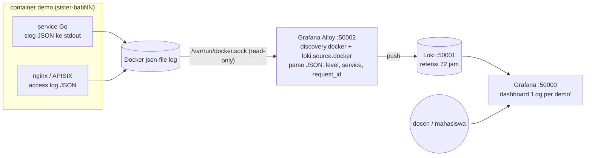
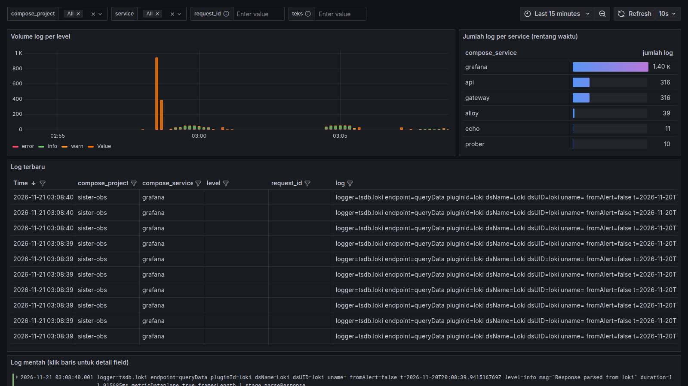

# Observability bersama: Grafana + Loki + Grafana Alloy

Stack log untuk **semua bab** (Bab 1–7, nanti Bab 8–14). Setiap demo cukup menulis log JSON satu
baris ke stdout; Alloy membaca log container lewat Docker socket, memberi label, dan mengirimnya ke
Loki; Grafana menampilkan dashboard "Log per demo".

Kaitan materi: observability dibahas di Bab 5 (microservices: correlation/request ID, log terpusat)
dan dipakai di semua slide demo (P01–P07) setiap kali dosen menelusuri satu request lintas service.

## Arsitektur



Label yang dipasang Alloy:

| Label | Asal |
|---|---|
| `compose_project` | label Docker `com.docker.compose.project` (mis. `sister-bab04`) |
| `compose_service` | label Docker `com.docker.compose.service` (mis. `katalog-1`) |
| `container` | nama container |
| `level` | field JSON `level`, dikecilkan (`info`, `warn`, `error`); fallback `level=` logfmt |
| `service` | field JSON `service` |
| `request_id` | field JSON `request_id`, disimpan sebagai **structured metadata** (bukan label, karena kardinalitasnya tinggi) |

Secara default Alloy **hanya** membaca container yang compose project-nya cocok dengan
`LOG_PROJECT_REGEX=sister-.*`. Container lain di mesin yang sama (server lab menjalankan puluhan
container proyek lain) tidak ikut dibaca, supaya log mereka tidak masuk Loki dan disk tidak terkuras.
Ubah regex di `.env` bila memang perlu.

## Menjalankan

```bash
cd shared/observability
cp .env.example .env        # ganti GRAFANA_ADMIN_PASSWORD; BIND_ADDR=10.100.21.22 di server lab
docker compose up -d
```

Atau dari root repo: `docker compose -f shared/observability/compose.yaml --env-file shared/observability/.env up -d`.

Buka Grafana: `http://${BIND_ADDR}:50000`. Mahasiswa bisa melihat tanpa login (anonymous, role
**Viewer**, tidak bisa mengubah dashboard). Dosen login sebagai `admin` dengan password dari `.env`.

## Tabel port

| Port host | Layanan | Keterangan |
|---|---|---|
| 50000 | Grafana | UI dashboard |
| 50001 | Loki | HTTP API (`/ready`, `/loki/api/v1/query_range`, ...) |
| 50002 | Grafana Alloy | UI debug pipeline (`/` grafik komponen, `/-/ready`) |
| 50098, 50099 | (cadangan) | dipakai `tools/perftest-desktop/cmd/demo-target` saat uji |

Semua port diikat ke `${BIND_ADDR}` (default `127.0.0.1`).

## Dashboard "Log per demo"

Folder **Sister Demo**, juga menjadi home dashboard. Variabel di bagian atas:

- `compose_project`: pilih satu atau beberapa demo (mis. `sister-bab04`);
- `service`: compose service di project itu;
- `request_id`: isi seluruh atau sebagian request ID untuk menelusuri satu request lintas service;
- `teks`: filter teks bebas (regex, tidak peka huruf besar/kecil).

Panel: volume log per level (bar bertumpuk per 10 detik), jumlah log per service, tabel log terbaru
(kolom time, project, service, level, request_id, log), dan log mentah (klik baris untuk melihat
semua field).



Dashboard milik bab disimpan di folder bab itu (`babNN-*/grafana/*.json`) dan dipasang read-only
ke `/var/lib/grafana/dashboards-bab/babNN` lewat volume di `compose.yaml`; saat ini Bab 1
(*Bab 1 · Cluster Visualizer*) dan Bab 5 (*Bab 5 · Toko daring microservices*). Bab baru yang punya
dashboard cukup menambah satu baris volume. Datasource yang dipakai: uid `loki`, atau variabel
datasource bertipe `loki`. Provisioning membaca ulang folder tiap 30 detik, tetapi baris volume baru
baru berlaku sesudah `docker compose up -d`.

## Skenario demo di kelas

1. Nyalakan stack ini sebelum kelas, lalu nyalakan demo bab hari itu.
2. Buka `http://${BIND_ADDR}:50000`, pilih `compose_project = sister-babNN`.
3. Klik sesuatu di UI demo (mis. kirim pesanan di Bab 5). Amati panel **Volume log per level**
   naik dan baris baru muncul di **Log terbaru**.
4. Salin satu `request_id` dari tabel, tempel ke variabel `request_id`. Sekarang hanya log request
   itu yang tampil, dari gateway sampai service paling belakang. Kaitkan dengan teori: di sistem
   terdistribusi satu operasi pengguna menyebar ke banyak proses, dan correlation ID adalah cara
   paling murah untuk merangkainya kembali (bandingkan dengan distributed tracing).
5. Matikan satu replica atau suntik fault di UI demo; filter `teks = error` dan tunjukkan bahwa
   error muncul di service mana dan kapan.

## Batas sumber daya

- Retensi Loki **72 jam** (compactor menghapus log lama), `reject_old_samples_max_age` 72 jam.
- Batas ingest 4 MB/s (burst 8 MB), per stream 2 MB/s, baris maksimal 64 KB (dipotong), 2000 stream.
- Database Grafana di **tmpfs** (256 MB RAM): semua datasource dan dashboard berasal dari
  provisioning, jadi tidak ada yang hilang saat restart kecuali preferensi/user yang dibuat lewat UI.
  Ini juga membuat start Grafana tidak tertahan oleh I/O disk server yang sibuk.
- `mem_limit`: Loki 768 MB, Alloy 512 MB, Grafana 512 MB; log container stack ini sendiri dibatasi
  `json-file` 10 MB x 2.
- Image: `grafana/grafana:11.4.0` (486 MB), `grafana/loki:3.3.2` (106 MB), `grafana/alloy:v1.5.1` (392 MB); tidak ada image yang dibangun.

## Uji otomatis

```bash
bash shared/observability/uji.sh
```

Skrip menyalakan stack, menjalankan satu container `alpine:3.20` berlabel
`com.docker.compose.project=sister-obs-uji` yang menulis log JSON (INFO dan ERROR) dengan
request_id unik, lalu memeriksa lewat API: log masuk Loki dengan label `compose_project`,
`compose_service`, `container`, `level`, `service` dan filter `request_id`; datasource dan dashboard
terprovisioning; anonymous viewer bisa membaca tetapi tidak bisa menulis dashboard. Bila stack sudah
menyala sebelum uji (dipakai demo lain), stack dibiarkan menyala; bila tidak, `down -v` di akhir.

## Membersihkan

```bash
docker compose -f shared/observability/compose.yaml down -v   # hapus container + volume log
```
