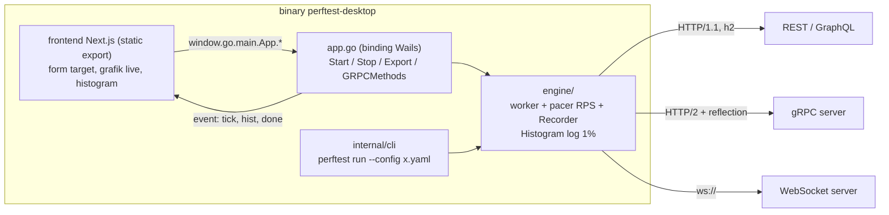
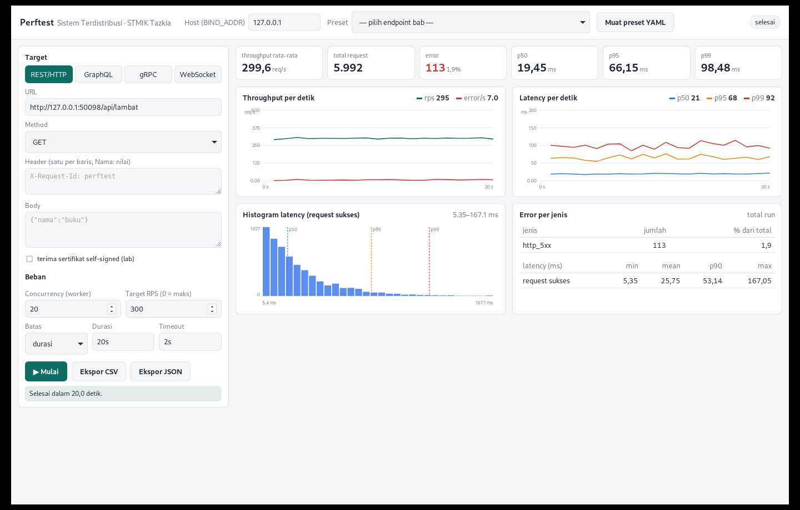
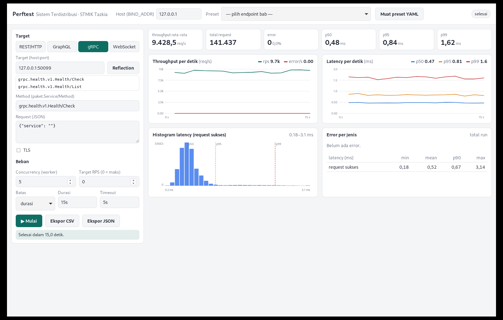

# perftest-desktop: aplikasi desktop perftest untuk semua demo

Aplikasi desktop untuk menguji beban (load test) endpoint demo tiap bab: **REST/HTTP**,
**GraphQL**, **gRPC** (lewat server reflection), dan **WebSocket**. Grafik live throughput dan
latency p50/p95/p99, error per jenis, histogram latency, ekspor CSV/JSON, dan preset endpoint
Bab 1–7. Binary yang sama juga punya **mode CLI** untuk uji otomatis tanpa layar.

Kaitan materi: latency, throughput, tail latency (p95/p99), dan hukum Little dibahas di Bab 1
(slide P01: metrik kinerja sistem terdistribusi); perbandingan protokol REST vs gRPC vs GraphQL vs
WebSocket di Bab 4 (P04); load balancer, gateway, dan circuit breaker di bawah beban di Bab 3 dan
Bab 5 (P03, P05); efek concurrency dan worker pool di Bab 6 (P06).

## Teknologi

- **Wails v2.10.1**: backend Go 1.24, jendela native memakai WebKitGTK 4.1 (Linux), WebView2
  (Windows), WKWebView (macOS). Tidak ada server HTTP atau port yang dibuka.
- **Frontend Next.js 15** (App Router, TypeScript) dengan `output: "export"`; hasil `frontend/out`
  di-embed ke binary dengan `go:embed`. Grafik digambar dengan SVG sendiri (tanpa library chart).
- **Mesin penghitung** di package Go terpisah `engine/` (tanpa ketergantungan UI) dengan unit test:
  load generator, pacing RPS, histogram latency, klasifikasi error, klien per protokol.



Binary `cmd/perftest` adalah CLI yang sama tanpa Wails (murni Go, `CGO_ENABLED=0`), cocok untuk
server dan CI.

## Cara kerja mesin (yang perlu dijelaskan ke mahasiswa)

- **Concurrency** = jumlah goroutine worker. Tiap worker mengirim request, menunggu respons, lalu
  mengirim lagi (*closed model*). Throughput maksimum ≈ concurrency / latency (hukum Little).
- **Target RPS** (opsional): pacer token bucket membagikan izin dengan laju tetap. Izin yang tidak
  terambil karena semua worker sibuk dibuang, jadi RPS tercapai hanya bila concurrency cukup. Ini
  sengaja diperlihatkan: naikkan RPS sampai latency melonjak atau RPS tidak tercapai lagi.
- **Batas**: durasi (mis. `30s`) atau jumlah request. Timeout per request default 5 detik.
- **Latency** dihitung untuk request **sukses** saja; error dihitung terpisah per jenis.
  Request yang terpotong karena run berakhir atau tombol Stop tidak dihitung.
- **Histogram** memakai bucket logaritmik lebar 1% (mirip HdrHistogram): memori tetap, p50/p95/p99
  akurat sekitar 1% berapa pun jumlah sampel.
- **Jenis error**: `timeout`, `conn_refused`, `conn_reset`, `dns`, `tls`, `http_4xx`, `http_429`,
  `http_5xx`, `graphql_errors` (HTTP 200 tetapi field `errors` terisi), `grpc_<Code>`
  (mis. `grpc_Unavailable`), `ws_closed`, `connect`, `other`.
- **WebSocket**: tiap worker membuka satu koneksi; satu "request" = kirim satu pesan lalu (bila
  dicentang) tunggu satu pesan balasan, sehingga latency = round trip. Untuk chat broadcast,
  matikan "tunggu balasan" (latency = waktu tulis) karena balasan bisa berasal dari klien lain.
- **gRPC**: hanya method unary. Tombol **Reflection** memanggil server reflection, mendaftar method,
  dan mengisi contoh JSON request; JSON diubah ke protobuf dengan `dynamicpb`.

## Menjalankan

### Binary yang sudah dibangun

```bash
./build/bin/perftest-desktop                                   # buka aplikasi
./build/bin/perftest-desktop --config examples/bab04-rest.yaml  # buka dengan form terisi
./build/bin/perftest-desktop --config x.yaml --autostart        # langsung mulai
BIND_ADDR=10.100.21.22 ./build/bin/perftest-desktop              # host default untuk preset
```

Di aplikasi:

1. Isi **Host (BIND_ADDR)**: `127.0.0.1` bila demo jalan di laptop, `10.100.21.22` bila demo jalan
   di server lab dan laptop tersambung wg0.
2. Pilih **Preset** (dikelompokkan per bab) atau isi target sendiri di tab REST/HTTP, GraphQL, gRPC,
   WebSocket. `${BIND_ADDR}` di URL diganti otomatis.
3. Atur concurrency, target RPS, batas (durasi atau jumlah request), timeout. Klik **Mulai**.
4. Amati kartu throughput, total, error, p50/p95/p99, grafik per detik, histogram, dan tabel error
   per jenis. **Stop** menghentikan run dan tetap menampilkan hasil sejauh itu.
5. **Ekspor CSV** (timeline per detik + baris total) atau **Ekspor JSON** (config, ringkasan,
   timeline, histogram).

**Muat preset YAML** membaca file preset lain (format sama dengan `presets/presets.yaml`).

### Mode CLI (tanpa layar)

```bash
go run ./cmd/perftest presets                       # daftar preset, nomor bab.urutan
go run ./cmd/perftest run --preset 4.1 --duration 30s --json hasil.json --csv hasil.csv
go run ./cmd/perftest run --config examples/bab04-rest.yaml --host 10.100.21.22
go run ./cmd/perftest grpc-list --target 127.0.0.1:50401
```

Binary desktop menerima perintah yang sama: `./build/bin/perftest-desktop run --config x.yaml`
(di Linux/macOS). Opsi `--max-error-rate 0.01` memberi exit code 1 bila rasio error di atas 1%,
berguna untuk uji otomatis.

Format skenario YAML (field sama dengan form):

```yaml
name: Bab 4 gRPC AmbilProduk
kind: grpc                 # http | graphql | grpc | ws
target: ${BIND_ADDR}:50401
grpcMethod: katalog.v1.KatalogService/AmbilProduk
request: '{"id": 1}'
concurrency: 20
duration: 30s              # atau requests: 5000
rps: 0                     # 0 = secepat mungkin
timeout: 5s
# http:    url, method, headers, body, insecureSkipVerify
# graphql: url, headers, query, variables (teks JSON)
# ws:      url, headers, message, noReply
```

### Server contoh lokal

`cmd/demo-target` menyediakan target untuk latihan tanpa menyalakan demo bab mana pun:
`/api/cepat`, `/api/lambat` (latency eksponensial ~20 ms + 5% error 503), `/graphql` (field
`halo`), `/ws` (echo), dan gRPC health + reflection.

```bash
go run ./cmd/demo-target            # HTTP 127.0.0.1:50098, gRPC 127.0.0.1:50099
./build/bin/perftest-desktop --config examples/demo-lambat.yaml --autostart
```

## Membangun

Prasyarat umum: Go 1.24+, Node.js 20 + npm, dan Wails CLI:

```bash
go install github.com/wailsapp/wails/v2/cmd/wails@v2.10.1     # tanpa sudo, masuk ~/go/bin
```

### Linux (laptop dosen p14s, server lab)

Butuh paket pengembangan GTK3 dan WebKitGTK **4.1** (`libgtk-3-dev`, `libwebkit2gtk-4.1-dev`,
`pkg-config`, `gcc`). Di mesin pengembangan semua sudah terpasang. Bila belum, pemilik laptop
memasangnya sekali (`sudo apt install libgtk-3-dev libwebkit2gtk-4.1-dev`); skrip repo ini tidak
memasang paket sistem.

```bash
cd tools/perftest-desktop
wails build -tags webkit2_41 -skipbindings -trimpath -ldflags "-s -w"
# hasil: build/bin/perftest-desktop (~16 MB)
```

Catatan: `wails doctor` melaporkan "libwebkit Not Found" karena hanya mencari WebKitGTK 4.0;
dengan tag `webkit2_41` build tetap berhasil (Ubuntu 24.04 ke atas hanya punya 4.1).

Tanpa Wails CLI (setara):

```bash
(cd frontend && npm ci && npm run build)
CGO_ENABLED=1 go build -tags desktop,production,webkit2_41 -trimpath -ldflags "-s -w" -o build/bin/perftest-desktop .
```

Untuk menghemat disk, hapus `frontend/node_modules` dan `frontend/.next` sesudah build; hasil
frontend sudah ada di dalam binary.

CLI saja (tanpa GTK/WebKit, statik):

```bash
CGO_ENABLED=0 go build -o build/bin/perftest ./cmd/perftest
```

### Windows

Wails mendukung Windows 10/11 dengan WebView2 (sudah bawaan Windows 11). Bisa dibangun di Windows
(`wails build -skipbindings`) atau **dari Linux** tanpa CGO:

```bash
wails build -platform windows/amd64 -skipbindings -trimpath -ldflags "-s -w"
# hasil: build/bin/perftest-desktop.exe
```

Build silang dari Linux ini sudah dicoba dan berhasil (17 MB), tetapi belum dijalankan di mesin
Windows. Binary Windows adalah aplikasi GUI, jadi mode CLI di Windows memakai
`GOOS=windows go build -o perftest.exe ./cmd/perftest`.

### macOS

Wails mendukung macOS 10.15+ (WKWebView), tetapi harus dibangun **di macOS** (butuh Xcode command
line tools): `wails build -skipbindings -platform darwin/universal`. Hasilnya
`build/bin/perftest-desktop.app`. Belum dicoba karena tidak ada mesin macOS.

## Skenario demo di kelas

1. **Hukum Little dan concurrency (Bab 1).** Nyalakan demo Bab 1, pilih preset
   *Bab 1 · nginx load balancer → 3 node*. Jalankan concurrency 1, 10, 50. Amati throughput naik
   hampir linear lalu mendatar, sementara p99 mulai naik. Hubungkan: throughput ≈ concurrency /
   latency; begitu node jenuh, menambah concurrency hanya menambah antrean (latency).
2. **Load balancer dan node mati (Bab 1/3).** Saat run 60 detik berjalan, matikan satu node lewat
   UI Bab 1. Amati lonjakan `http_5xx`/`conn_refused` atau p99 sesaat, lalu pulih ketika nginx
   mengeluarkan node dari pool.
3. **REST vs gRPC vs GraphQL (Bab 4).** Jalankan preset 4.1 (REST), 4.7 (gRPC DaftarProduk), dan
   4.3 (GraphQL) dengan concurrency sama, 20 detik masing-masing. Ekspor CSV ketiganya dan bandingkan
   p50/p99 dan throughput. Lalu bandingkan 4.3 vs 4.4: GraphQL tanpa DataLoader (N+1 query) vs
   dengan DataLoader.
4. **Tail latency.** Pakai `demo-target` `/api/lambat`: p50 ~20 ms tetapi p99 ~100 ms. Tunjukkan di
   histogram bahwa rata-rata menyembunyikan ekor, dan mengapa SLO ditulis dengan p99.
5. **Target RPS dan saturasi (Bab 5/6).** Set concurrency 10, naikkan target RPS 100 → 500 → 2000.
   Amati kapan RPS tidak lagi tercapai (concurrency kurang) dan kapan latency melonjak (server
   jenuh). Buka Grafana (`:50000`) dan tunjukkan log demo yang sama ikut melonjak.
6. **WebSocket chat (Bab 2/4).** Preset 2.1 atau 4.9 dengan 10 koneksi, RPS 50: UI chat bab itu
   dibanjiri pesan "halo dari perftest" secara live.

## Screenshot

Diambil headless dengan Xvfb (`uji.sh` melakukan hal yang sama):





## Struktur folder

```
tools/perftest-desktop/
  main.go, app.go        aplikasi Wails (binding Start/Stop/Export/GRPCMethods/...)
  wails.json             konfigurasi Wails (frontend:dir, build: npm run build)
  engine/                mesin: config, runner, pacer RPS, histogram, recorder, klien, ekspor + test
  presets/               presets.yaml (embed) + loader + test
  internal/cli/          mode CLI (dipakai cmd/perftest dan binary desktop)
  cmd/perftest/          binary CLI murni Go
  cmd/demo-target/       server contoh lokal (HTTP, GraphQL, gRPC, WebSocket)
  examples/              skenario YAML contoh
  frontend/              Next.js (static export ke frontend/out)
  build/                 ikon dan manifest Wails; build/bin/ hasil build (tidak di-commit)
  uji.sh                 uji otomatis tanpa layar (+ screenshot GUI bila Xvfb ada)
```

## Uji otomatis

```bash
bash tools/perftest-desktop/uji.sh
```

Menjalankan gofmt, go vet, unit test `engine` dan `presets` dengan `-race`, build CLI dan
demo-target, lalu CLI terhadap demo-target: GraphQL, gRPC, WebSocket (500 request sukses masing-masing),
HTTP `/api/lambat` dengan klasifikasi `http_5xx`, akurasi target RPS, ekspor CSV/JSON, `grpc-list`, dan exit code
`--max-error-rate`. Bila `build/bin/perftest-desktop` ada dan Xvfb tersedia, GUI dijalankan
headless dengan `--autostart` dan screenshot disimpan di `build/bin/uji-gui.png`. Tidak memakai
Docker; port 50098/50099 hanya selama uji.

## Membersihkan

```bash
rm -rf build/bin frontend/node_modules frontend/.next
find frontend/out -mindepth 1 ! -name .gitkeep -delete
```
